# Design Document: Distributed proving backend for Creusot

## Overview

This design implements R1.1 to R7.13 of `requirements.md` in the same folder. It cites requirement (R), property (P), assumption (AS), non-goal (NG), trusted-item (TB), open-question (OQ-N) and numeric (TBD) IDs from that document and does not restate their text. New assumptions and trusted items that this design needs are marked *proposed* (for example, proposed AS-36); they are listed under Design Decisions for the user to add to `requirements.md`. Numeric values stay `<TBD-n>`.

### Goals

- Deliver the six stages as increments that each pass their own verification gates (Delivery Plan), with certificates delivered before any sharing stage, as the Scope and Proposed Split section of `requirements.md` orders.
- Keep R7.1 true at every increment: no configuration, fault or hostile remote party makes the Verdict_Recorder record a proof label for a Goal_Version whose locally printed Printed_Goal is satisfiable, unless a trusted item listed below for that label fails.
- Reuse why3find's goal generation, per-goal strategy, tactics, prover configuration and Calibration. Change Creusot, Why3, why3find and the solvers only through small patches under `patches/` (R7.9).
- Give every requirement the checks that its Verification subsection names, at the levels that its Class requires (R7.11 criterion 4).

### Central idea

1. **A pure decision core inside imperative shells.** Every decision function of R7.3 criterion 1 lives in `crates/dp-core` as a deterministic function or as a step of one of four state machines (Front_End, Coordinator, Worker, Lemma_Pool). The shells (`dp-frontend`, `dp-coordinator`, `dp-worker`, `dp-pool`, `dp-replay`) only do I/O: they parse input, compute *facts* (hashes, signature checks, local prints, Canonical_Names, checker outcomes, clock readings), pass the facts to dp-core as fields of an event, and carry out the effects that dp-core returns. Creusot (A1) and Kani (A2) verify dp-core. The same machines run unchanged in deterministic simulation (A4), and each step names one TLA+ action, so implementation traces can be validated against the specifications (A2, R1.5 criteria 10 to 12).
2. **Every proof label is decided locally.** The Front_End computes every Assurance_Label from data it produced or pinned itself: `print_local` (R1.3 criterion 3), the Lock_File, the TCB_Document, the operator-signed Worker registry, Canonical_Names re-derived from `print_local` (R4.1 criterion 14) and local Certificate_Checker runs (R5.3). Results, Lemmas, Instantiation_Hints, proofs, Coordinator messages and remote Result_Cache entries are untrusted input. They can propose a proof; they never decide one.
3. **Two routes to a proof label.** A Result becomes proved-standalone (R7.1 criterion 2) or certified (R7.1 criterion 3), or it gets a non-proof label. Any failure on the way to either proof label yields a non-proof label (fail-safe rule, Error Handling).

### Trust boundary

`docs/tcb.toml` is the authoritative list (R7.8). This table summarizes it.

| Assurance_Label | Trusted: a failure here could make the label wrong | Untrusted: checks catch their mistakes |
|---|---|---|
| proved-standalone | NG-1, NG-2 (including the why3find dispatch patch's printing path, proposed TB-23); NG-3 with TB-12 and TB-22 (Unpatched_Solvers, their option lists and Lock_File marks; OQ-N37); NG-7 with TB-2 and TB-13 (authenticated Workers, Worker credentials, operator signing key); TB-1, TB-9, TB-10, TB-16, TB-17; AS-9, AS-35 | Coordinator, network, Lemma_Pool, Sharing_Solvers, unauthenticated or revoked Workers |
| certified | NG-1, NG-2 (proposed TB-23); TB-3 or TB-4 with TB-11 (pinned checker, option list, signature files, checker-output table); TB-1, TB-9, TB-16, TB-17; AS-6, AS-30 | every solver, proof producer and Worker; Coordinator, network, Lemma_Pool; Canonicalizer, Admission_Checker and Certificate_Composer (defense in depth only) |
| A1 claims about either label | TB-5 (Lean 4 kernel), TB-6 (Creusot), TB-7 (Kani), TB-8 (TLC, Apalache); AS-12, AS-13 | — |

In certify-all mode (R5.5) only the certified row applies.

### Research findings that shape the design

- why3find's proof server is a central proxy that keeps the proof database; `why3find client` processes connect to it and offer their local provers, and the server uses each client's Calibration to keep distributed results consistent ([why3find README](https://github.com/xldenis/Why3-Find/blob/master/README.md)). The design keeps why3find's prover configuration and Calibration and replaces the central proxy (decision D-1).
- Ethos, given a reference input (`--reference=X`), checks that every `assume` of a proof is an assertion of the reference file; `--require-proof-of-false` makes it require that the last step proves false at assumption level zero; it answers `incomplete` when a step uses a rule marked `:sorry`. Reference files may not contain `define-fun-rec`, `define-funs-rec`, `push` or `pop`, and `define-fun` in a reference file is read as an assertion unless `--reference-define-fun` is set ([Ethos user manual](https://github.com/cvc5/ethos/blob/main/user_manual.md)). These facts support AS-30 for Ethos, fix part of the CPC option list (Data Models), and give proposed AS-38.
- cvc5 emits CPC proofs that Ethos checks ([cvc5 NEWS](https://github.com/cvc5/cvc5/blob/main/NEWS.md)); CPC is a calculus of several hundred rules written in Eunoia ([Reynolds et al.](https://u.cs.biu.ac.il/~zoharyo1/cav26.pdf)). By default cvc5 shares proof terms through global definitions (`proof-dag-global`) and allows trust steps in printed proofs (`proof-allow-trust`) ([cvc5 options](https://cvc5.github.io/docs/latest/options.html)). Global definitions are commands outside the supported fragment of R5.2, so proof-producing runs turn both options off (proposed AS-36).
- Carcara checks an Alethe proof against the original SMT-LIB problem file (`carcara check proof problem`) ([Carcara README](https://github.com/ufmg-smite/carcara)). This supports AS-30 for Carcara; the hole-reporting part of AS-6 stays To check, so R5.3 criterion 15 applies.
- Checking that traces of a distributed program are behaviors of a TLA+ specification reduces to model checking with TLC constrained by the logged events ([Cirstea, Kuppe, Loillier and Merz](https://arxiv.org/abs/2404.16075)). Trace validation (R1.5 criteria 10 to 12) follows that method.

Content was rephrased for compliance with licensing restrictions.

## Architecture

### Components and trust boundaries

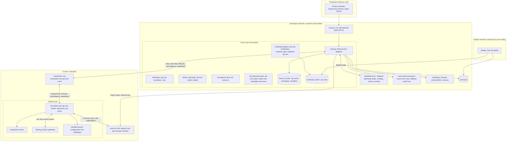

Everything inside the Cluster box is untrusted (verification policy). The Front_End trusts only the developer machine's local tools at their Lock_File hashes. The Replay_Tool trusts only the auditor machine's pinned tools (R7.6).

### Repository layout refinements

The planned layout of `requirements.md` stands, with these additions. The Traceability_Table remains the authoritative mapping (R7.11).

| Path | Change | Reason |
|---|---|---|
| `crates/dp-coordinator/` | added | I/O shell of the Coordinator (D-1). |
| `crates/dp-shell/` | added | Shared `Env` trait and adapters (transport, clock, process runner, file store), used by every shell and by `tests/sim/`. |
| `crates/dp-testkit/` | added | Test-only crate with the shared proptest configuration and generators (Testing Strategy). |
| `crates/dp-core/src/{machine,frontend,coord,worker,forward,calibration,config,trace}.rs` | added modules | The four state machines, configuration validation and the TLA+ action names. |
| `proofs/lean/DP/Ref/` | added | Executable Lean reference definitions, compiled into the binary `dp-lean-ref` for the `*_lean_vs_rust` differential tests. |
| `verification/tla/actions.toml` | added | Generated table from dp-core action names to TLA+ actions, read by `ci/trace-validation`. |
| `patches/why3find/`, `patches/creusot/`, `patches/cvc5/`, `patches/z3/` | content | Dispatch mode (D-3), the Creusot_CLI backend option (D-4), Sharing_Solver patches (R3.1, R4.4). |

### Process, language and protocol boundaries

- **Coordinator (OQ-N1, decision D-1).** The Coordinator is a new Rust service, `dp-coordinator`, around the dp-core Coordinator machine. It plays the Proof_Server role of R1.1: it is the endpoint that the cluster option names, it queues Jobs, assigns them to Workers by their offers and Calibrations (AS-4), and forwards Results. It replaces the central proxy of `why3find server` rather than extending it, because R7.3 criterion 1 puts assignment, eligibility, retry, heartbeat timeout and cancellation in dp-core, trace validation needs one event per protocol action, and the patch-size limit `<TBD-21>` rules out a large OCaml patch. The Coordinator is untrusted either way, so the choice does not change any label.
- **Workers.** `dp-worker` is the Worker's network endpoint and shell. It reads the Worker host's prover configuration and runs why3find's Calibration procedure through the why3find bridge (D-3), so offers carry why3find's Calibrations (R1.1 criterion 3, AS-4). It starts each solver process itself, in its own process group, with the command line from the pinned Why3 prover configuration and the Job's seed and options (AS-21 fallback path, proposed AS-39). Starting solvers in dp-worker gives the per-Job Lemma socket for Sharing_Solvers, the record-before-write order (R3.1 criterion 10), a binary hash check just before each start, process-tree termination (R1.4 criterion 5, R1.5 criterion 5) and one trace event per action.
- **Language (OQ-N2, decision D-2).** All new components are Rust. OCaml code exists only inside the small why3find patch. The boundary is a process boundary: dp-frontend starts the patched why3find as a child and talks to it over a pipe with canonical S-expressions (registered in `docs/formats/`). There is no FFI, so Creusot and Kani see only Rust and the OCaml runtime stays out of the Rust processes.
- **why3find dispatch mode (D-3, proposed AS-37).** The patch adds `why3find prove --dispatch`. In this mode why3find still generates Goals, runs its per-goal strategy and tactics (such as `split_vc`) and writes the legacy part of `proof.json`, but it sends every prover call and every read or write of its own cache to dp-frontend and waits for the answer. Each prover call names the Goal (why3find goal path and Goal_Hash), the strategy step (first sequential pass, reference-time parallel pass, or another step), the provers and the time. The patch also answers four requests from dp-frontend: print a Goal with a given Driver and Transformation_Pipeline (returning the exact bytes and the number of tasks, for `print_local` and R1.3 criterion 10), print the untransformed Why3 task deterministically (for the Goal_Hash, AS-33), report the detected provers with their command lines, and report the Calibration of a prover.
- **Creusot_CLI (AS-2, R7.9, decision D-4).** A small patch under `patches/creusot/` adds a backend option to `cargo creusot prove`. With the option, Creusot_CLI runs `dp-frontend prove` with the arguments it would pass to `why3find prove`, forwards its output (labels, summary and conflicts, R7.2 criteria 2 and 9) and returns its exit status (R7.2 criterion 12). Without the option, Creusot_CLI runs unmodified why3find as today. With the option but without the cluster option, dp-frontend proves locally (R1.1 criteria 2 and 8); with every feature off it is the legacy configuration of R7.12.
- **Transport.** dp-frontend, dp-coordinator, dp-worker and dp-pool exchange canonical S-expression messages (Data Models) over ZeroMQ TCP sockets, the transport why3find's proof server already uses (AS-4). Transport encryption is optional and never relied on: every message that matters for a label is authenticated end to end (R7.1 criterion 7) or re-derived locally.

### The dp-core decision core

#### Machine interface

```rust
// crates/dp-core/src/machine.rs
pub trait Machine {
    type Config;
    type State: Clone + Eq;
    type Input;   // one event: a parsed message plus shell-computed facts, a timer tick, or a process exit
    type Effect;  // one I/O request for the shell
    fn init(cfg: &Self::Config) -> Self::State;
    fn step(s: Self::State, i: Self::Input) -> Step<Self::State, Self::Effect>;
}

pub struct Step<S, E> {
    pub state: S,
    pub effects: Vec<E>,
    pub action: TlaAction,   // exactly one action of Coordinator.tla (R1.5 criterion 10)
    pub log: Vec<LogEntry>,  // discards, rejections with reason category, warnings
}
```

Every input carries `now`, the shell's clock reading, so dp-core reads no clock (R7.3 criterion 2). Session identifiers, Coordinator incarnation identifiers and message nonces are generated by the shells and passed in. dp-core uses no hash maps whose iteration order reaches an output (P7.3.1); ordered maps only.

#### Events and effects

| Machine | Main input events | Main effects |
|---|---|---|
| Front_End (Scheduler and Verdict_Recorder) | Session start (configuration, Lock_File, TCB_Document, registry); Goal announced; print facts (Task_Hash, task count, canonicalization); cache entry facts; prover call from why3find; local process exit; Result facts (parse, size, canonical form, signature, registry view, local Task_Hash, local import-set hash, Partition facts); failure, no-eligible-Worker and cancelled reports; Coordinator message with incarnation; registry or revocation facts; proof received; composition outcome; checker outcome tuple; storage outcome; tick | reply to why3find; print request; cache lookup or store; local start or kill; Job submission with task blob; cancellation; heartbeat; import fetch; proof request; compose request; checker run; store request; `proof.json` write; Creusot_CLI report; exit status; Session-end to the Lemma_Pool |
| Coordinator | Worker connect (credential facts, offer); Worker heartbeat; Job submission; Result (forwarded opaque); cancellation; Front_End heartbeat; operator command (authentication fact); signed registry or revocation; tick; restart | assignment with local time limit; cancellation to a Worker; forward to a Front_End; failure, no-eligible-Worker and cancelled reports; status report; Session-drop to the Lemma_Pool |
| Worker | assignment; cancellation; solver exit; solver export (canonicalization and renaming facts); Lemma or hint from the Lemma_Pool (parse, identifier, signature facts); Lemma_Pool connection change; tick | start solver; terminate process tree; send Result (the shell signs it); send pool item; write Lemma or instance to solver (after recording delivery); Job registration; Job end |
| Lemma_Pool | pool item (size, parse, identifier facts); Job registration; Job end; Session-end; Session-drop; restart; tick | forward pool item to a registered Job; log |

#### Modules, decision functions and requirements

| Module | Decision functions | Implements | Verification (level, artifact, job) |
|---|---|---|---|
| `escalation.rs` | `escalate`, `cache_excludes` | R1.2 | A1 Creusot `ci/creusot`; A2 `Coordinator.tla` `ci/tlc`; A4 `prop_escalation.rs` `ci/test` |
| `race.rs` | `classify_hard`, `form_race`, `next_submissions`, `on_job_end`, `end_race`, `partition_jobs` | R2.2, R3.5 criteria 1, 7, 9 | A1 `ci/creusot`; A2 `ci/tlc`, `sched/apalache-nightly`; A4 `prop_race.rs` |
| `verdict.rs` | `accept_result`, `label`, `record_verdict`, `cache_label`, `final_verdicts` | R1.3, R1.5 criteria 1, 2, 8, 9, 13, 16, R7.1, R5.5 | A1 `ci/creusot`; A2 `verification/kani/coordinator.rs` `ci/kani`; A4 `prop_accept.rs`, `prop_verdict.rs`, `prop_record.rs` |
| `labels.rs` | `label_from_checker_output`, `most_informative`, `classify` | R5.3, R7.2 | A1 `ci/creusot`; A4 `prop_verdict.rs`, `label_lean_vs_rust/` |
| `coord.rs` | `eligible`, `assign`, `on_heartbeat_timeout`, `on_failed`, `cancel`, `orphan_cancel`, `drop_session`, `apply_operator`, `status` | R1.1 criteria 3, 4, 7, R1.4 criteria 1, 3, 4, R1.5 criteria 4, 7, 15, R1.6, R1.7 | A2 `ci/tlc`, Kani `coordinator.rs`; A4 `prop_assign.rs`, `prop_operator.rs`, `prop_idempotent.rs` |
| `calibration.rs` | `scale`, `calibration_ok`, `limits_match` | R1.4 | A2 Kani `calibration.rs`; A4 `prop_calibration.rs` |
| `worker.rs` | `on_assign`, `on_cancel`, `on_export`, `on_pool_item`, `pending_release`, `on_exit` | R1.4 criterion 5, R1.5 criteria 5, 6, R3.1 criteria 1, 4, 6 to 10, 12 to 17, R4.1 criteria 13, 19, R4.3 criterion 5, R4.4 criteria 1, 4, 14 | A4 `prop_cancel.rs`, `prop_forward.rs`, `prop_pending.rs` |
| `forward.rs` | `forward_ok` (same Goal_Version, cross-goal, hint) | R3.1 criteria 3, 11, R4.2 criteria 2 to 4, R4.4 criterion 6 | A2 `Sharing.tla`; A4 `prop_forward.rs`, `prop_scope.rs` |
| `provenance.rs` | `prov_wf`, `default_deps` | R3.2 | A1 `ci/creusot`; A4 `prop_provenance.rs` |
| `admission.rs` | `hygiene_ok`, `is_ground_lemma`, `export_filter`, `admit`, `readmit` | R3.3, R3.4, R4.1 criterion 12, R4.2 criteria 5, 6, R4.3 | A1 `ci/creusot`, Lean `Admission.lean`; A4 `prop_admission.rs`, `prop_hygiene.rs`, `prop_ground.rs`, `admission_lean_vs_rust/` |
| `hints.rs` | `admit_hint`, `instantiate`, `hint_export_filter` | R4.4 | A1 `ci/creusot`, Lean `Hints.lean`; A4 `prop_hints.rs`, `hints_lean_vs_rust/` |
| `pool.rs` | `insert`, `delete_session`, `restart` | R3.6 | A2 Kani `pool.rs`; A4 `crates/dp-pool/tests/prop_pool.rs` |
| `certification.rs` | `needs_cert`, `import_closure`, `oblig`, `extended_problem`, `lemma_problem`, `cert_start`, `deadlines`, `leaf_select` | R5.1 | A1 `ci/creusot`; A2 `ci/tlc`; A4 `prop_certification.rs` |
| `compose_plan.rs` | `compose_plan` | R5.2, R3.2 criteria 8, 9 | A1 `ci/creusot`, Lean `Compose.lean`; A4 `prop_compose.rs`, `compose_lean_vs_rust/` |
| `fragment.rs` | `fragment_ok` | R5.2 criteria 15, 16, R5.3 criterion 19 | A1 `ci/creusot`; A4 `prop_fragment.rs` |
| `cache_key.rs` | `encode_key`, `lookup_ok`, `validate_entry` | R7.5 | A1 `ci/creusot`; A2 Kani `cache_key.rs`; A4 `prop_cache_key.rs` |
| `config.rs` | `validate_config` | R1.1 criterion 6, R1.2 criterion 7, R1.6 criteria 7, 18, R2.1 criteria 3 to 5, R2.2 criterion 17, R4.2 criterion 8, R5.5 criterion 5 | A4 `prop_config.rs`, `heartbeat_margin.rs`, `tests/integration/config/` |
| `trace.rs` | `TlaAction` | R1.5 criterion 10 | A2 `ci/trace-validation` |

`tools/purity-check/registry.toml` lists each public decision function above with its module and requirement (R7.3 criterion 4).

#### How the shells drive dp-core

Each shell runs one loop per machine instance:

```text
loop:
  input   := env.next_input()              # receive, parse (dp-formats), compute facts, read clock
  step    := Machine::step(state, input)   # pure
  env.trace(step.action, input, effects)   # one trace record per step, before any effect
  state   := step.state
  for e in step.effects: env.perform(e)    # send, start, kill, write, print, check
```

The facts that matter for labels are computed in named A3 modules: `crates/dp-frontend/src/accept.rs` (Task_Hash recomputation, task count, Partition_Assumptions, signature and registry checks, import-set hash, re-admission inputs, cache-entry re-checks), `crates/dp-formats/src/canonical_check.rs` (R7.10 criterion 8) and `crates/dp-cert/src/check.rs` (checker runs and binding facts). dp-core decides from these facts; it never trusts a fact it can recompute from other inputs (for example, it compares the Result's Task_Hash with the local one itself).

#### Simulation and trace validation

`tests/sim/` instantiates every shell with `SimEnv` from `dp-shell`: one seeded discrete-event scheduler, virtual clocks, a simulated network with the fault model of R1.6 (crashes and restarts, partitions, delays up to D, duplicates, reordering, loss), stub solvers that answer from a script and export scripted Lemmas, stub proof producers and stub checkers with scripted outcomes and delays, and an adversarial Coordinator that sends any message of the message grammar, replays and swaps Results and Partition Results, injects self-registered Workers and forged revocations (P1.3.3, P1.3.9, P1.7.2). Because the shells are the production shells with a different `Env`, simulation covers the shell code paths, not only dp-core (P7.3.2).

Every step writes one trace record: component identity, per-component sequence number, the `TlaAction` with its parameters, and for a receive the identifier of the matching send (R1.5 criterion 10). `Coordinator.tla` includes the actions of `Sharing.tla` through `INSTANCE` with a constant `SharingEnabled`, so every record of every component names an action of `Coordinator.tla` as R1.5 criterion 10 requires; `ci/tlc` checks `Coordinator.tla` with `SharingEnabled = FALSE` and `Sharing.tla` on its own to keep the state space small. `ci/trace-validation` merges the per-component traces into the partial order given by sequence numbers and send-receive pairs and checks, with the trace-validation specification `verification/tla/traces/CoordinatorTrace.tla` in the style of Cirstea et al., that some interleaving is a behavior of `Coordinator.tla` (R1.5 criteria 11 and 12). `verification/tla/actions.toml` is generated from `TlaAction`; a record whose action is absent from it fails the job (R1.5 criterion 12).

Event tracing is always on (OQ-N27, decision D-11): the records are the events that the shells already build, written to a buffered append-only file per component. User Sessions keep a bounded ring of recent traces; CI and evaluation runs keep complete traces.

### Key flows

#### (a) Session

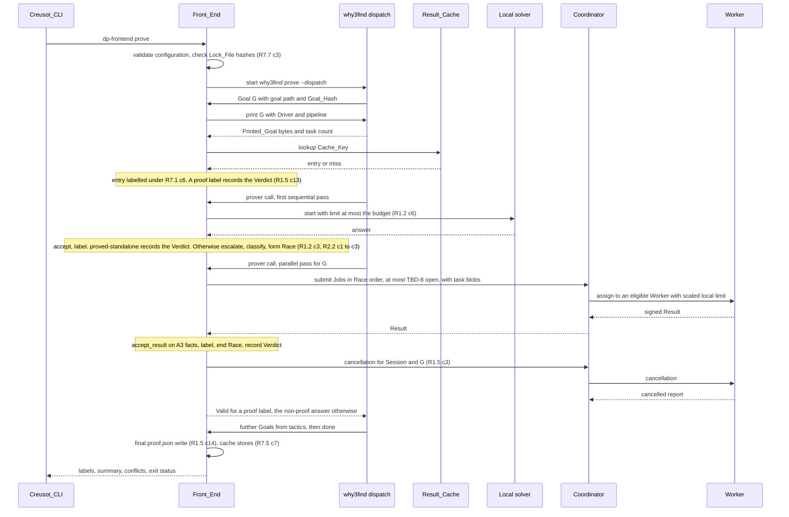

#### (b) Within-goal sharing

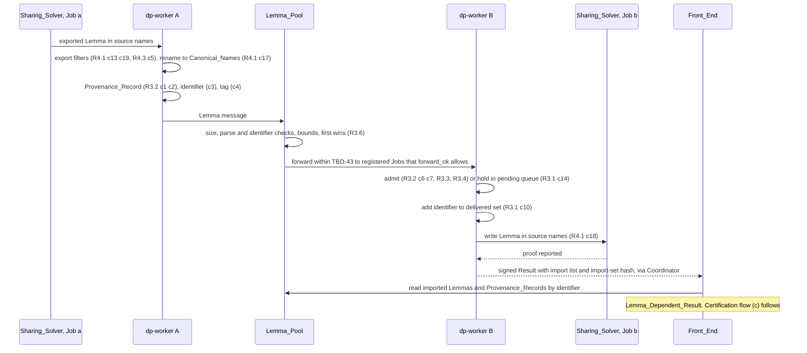

#### (c) Certification

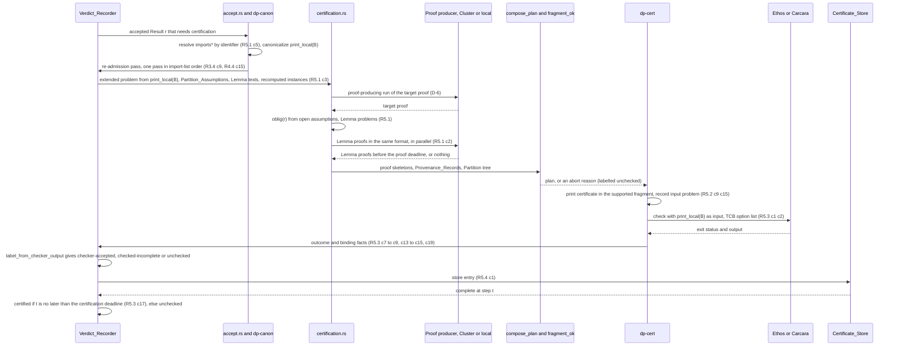

#### (d) Fault handling

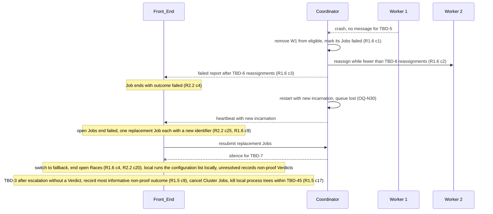

#### (e) Offline replay

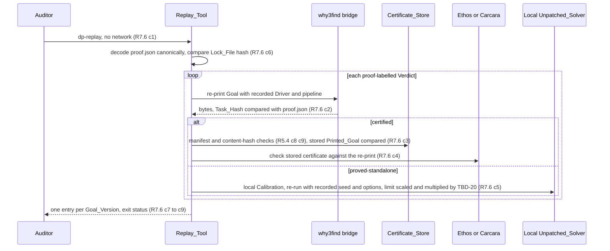

### State machines

#### Job, as the Front_End counts it

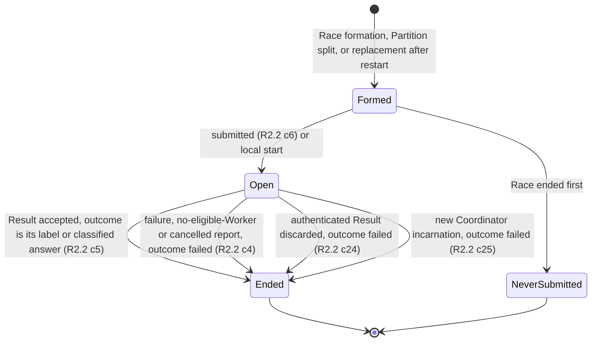

On the Coordinator a Job is queued, assigned, running, then finished, failed (and requeued while fewer than `<TBD-6>` reassignments, R1.6 criterion 2) or removed by a cancellation (R1.5 criterion 4).

#### Race

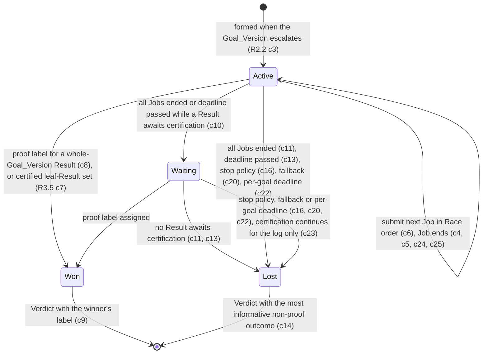

#### Result labelling

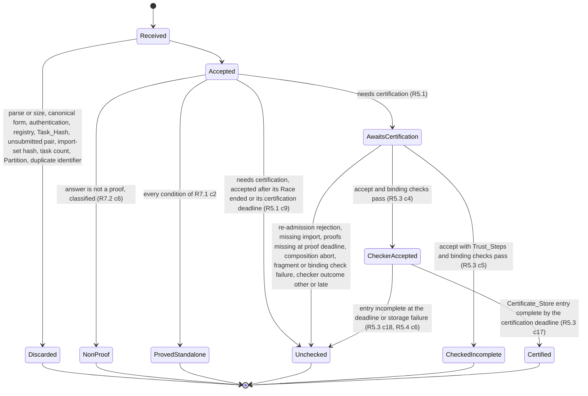

checker-accepted is a state, not an Assurance_Label (Glossary).

## Components and Interfaces

Each component lists its responsibilities, its interfaces, the requirements it implements and its verification. Verification entries name level, tool, artifact and job; where a requirement's Verification subsection already lists the checks, the entry cites the requirement instead of repeating them.

### C1 Creusot_CLI backend patch (`patches/creusot/`)

- **Responsibilities.** Add the backend option (D-4); run `dp-frontend prove` with the arguments of `why3find prove`; forward output and exit status.
- **Implements.** R7.2 criteria 2, 9 and 12 (display and exit status through dp-frontend), R7.9; AS-2.
- **Verification.** A4 output snapshot test `tests/integration/cli_labels/` (`ci/integration-cluster`); patch application, header and size checks `tools/patch-check/` (`ci/patches`).

### C2 why3find dispatch patch (`patches/why3find/`)

- **Responsibilities.** Dispatch mode of `why3find prove` (D-3): Goal announcements, prover calls tagged with the strategy step, cache reads and writes, and the legacy part of `proof.json`, all driven by dp-frontend's answers. Bridge requests: print a Goal with a Driver and Transformation_Pipeline and count the tasks; deterministic print of the untransformed task; detected provers with command lines; Calibration of a prover.
- **Interfaces.** Canonical S-expression requests and replies over the child's stdin and stdout (format `dispatch` in `docs/formats/index.toml`). A closed pipe is fatal: why3find then exits without writing `proof.json`.
- **`proof.json` sequence.** When its run ends, why3find writes its `proof.json` files with the legacy fields, in which a goal is proved only if dp-frontend answered Valid, which it does only for proof-labelled Verdicts. dp-frontend then rewrites each file atomically with the `dp` members and `dp-lock` added; that rewrite is the final write of R1.5 criterion 14.
- **Implements.** The why3find side of R1.2 (first sequential pass), R1.3 criteria 3 and 10 (printing, task count), R2.3 criterion 5 and R7.2 criterion 3 (legacy `proof.json` fields), R7.5 criterion 7 (legacy-layout writes only when dp-frontend marks a Result proved-standalone), R7.12.
- **Trust.** NG-2 and proposed TB-23: the patch returns the bytes that the pinned Driver prints and the task count that the pinned pipeline yields.
- **Verification.** A4 differential tests `tests/diff/legacy_compat/` and `tests/diff/legacy_reader/` (`ci/diff`); `tests/diff/export_vs_why3find/` compares dispatch-mode prints with bytes captured from unmodified why3find (`ci/diff`); `ci/patches`.

### C3 Front_End (`crates/dp-frontend/`)

- **Responsibilities.** One Session per invocation: configuration validation, Lock_File checks at start and before each start of a local executable (R7.7 criteria 3, 4, 7), the dispatch loop with why3find, the Front_End machine of dp-core, local solver runs in their own process groups, Cluster connection and heartbeats, acceptance facts (`accept.rs`), import resolution, the re-admission pass, certification orchestration, Result_Cache, Certificate_Store writes through dp-cert, the final `proof.json` write and the Creusot_CLI report.
- **Interfaces.** Dispatch pipe to why3find (C2); ZeroMQ to the Coordinator (Job submission, task blob, cancellation, heartbeat, proof request; receives Results, reports, registry and revocations); ZeroMQ to the Lemma_Pool (import reads by identifier, Session-end); child processes for solvers and checkers; files `proof.json`, `.dp-cache/`, `.dp-certs/`, `.why3find` through why3find only.
- **Local facts for acceptance (A3, `accept.rs`).** For every Result: canonical-form check of the message (R7.10 criterion 8); size limit; Ed25519 verification under the highest-version operator-signed registry the Front_End holds, and the revocations it holds (R1.3 criteria 2, 4, 9, R1.7 criterion 6); `print_local` of the named Goal with the Result's Driver and Transformation_Pipeline, with the recorded Partition_Assumptions appended for a Partition Result, its Task_Hash and the task count (R1.3 criteria 3 and 10, R3.5 criteria 4 and 5); the import-set hash over the listed imports (R1.3 criterion 7); the recomputed local time limit (R1.4 criterion 6). dp-core `accept_result` compares and decides.
- **Implements.** R1.1 criteria 1, 2, 5, 6, 8; R1.2; R1.3 criteria 3 to 10; R1.5 criteria 2, 3, 9, 13, 14, 16, 17; R1.6 criteria 4 to 9, 13, 15, 20; R1.7 criterion 6; R2.1 criteria 1 to 6; R2.2; R2.3; R3.1 criteria 2, 5; R3.4 criteria 9, 10; R4.1 criterion 14; R4.2 criteria 1, 8; R4.4 criteria 15, 16; R5.1 to R5.5 (orchestration); R7.1; R7.2; R7.5; R7.7 criteria 3 to 5, 7.
- **Verification.** A3 `accept.rs` (`ci/sim`, `ci/canaries`, `ci/certs`); A4 per the Verification subsections of R1.1 to R1.6, R2.1 to R2.3, R7.1, R7.2, R7.5 and R7.7 (`tests/integration/`, `tests/sim/`, `tests/diff/`, `tests/canaries/`); mutation testing of `crates/dp-frontend/` (`sched/mutants-weekly`, R7.13 criterion 1).

### C4 Scheduler and Verdict_Recorder (dp-core Front_End machine)

The Scheduler and the Verdict_Recorder are the decision parts of the Front_End machine (`escalation.rs`, `race.rs`, `verdict.rs`, `labels.rs`, `certification.rs`). Their rules are those of R1.2, R2.2, R1.5 and R7.1; the design adds only these choices:

- **Strategy-step mapping.** A prover call tagged as why3find's first sequential pass belongs to the Local_Fast_Pass and runs locally with its limit clamped to the budget (R1.2 criterion 6). The first later prover call for a Goal_Version that has escalated is answered from that Goal_Version's Verdict; why3find then continues its strategy with tactics on the answer.
- **Configuration list** of an Escalated_Goal that is not a Hard_Goal: the provers and time of why3find's reference-time parallel pass in the project configuration, one Solver_Configuration each, with the Driver and Transformation_Pipeline of why3find's prover configuration (OQ-N43 resolved).
- **The label function.**

```text
label(r, ctx):
  if not reports_proof(r):            return classify(r.answer, lemma_dependent(r, ctx))   # R7.2 c5, c6
  if r.partition != none:             return label_of_leaf_set(r)  # a Partition Result is labelled only with its
                                                                   # leaf-Result set, certified or not (R3.5 c2, R5.1)
  if needs_cert(r, ctx):              return cert_label(r)        # R5.1, R5.3; unchecked until checker-accepted and stored
  return proved-standalone            # every condition of R7.1 c2 holds here
needs_cert(r, ctx)      = reports_proof(r) and (ctx.certify_all or lemma_dependent(r, ctx))
lemma_dependent(r, ctx) = ctx.import_mark(job(r)) or r.imports != [] or r.imports_hash != H(canon([]))
                          or (r.config.prover, r.config.version, r.binary_hash) not in unpatched(ctx.lock)
                          or ctx.local_binary_mismatch(r)                                    # R1.3 c5, R3.1 c5, R7.7 c7
```

- **Verification.** As in the module table of the Architecture section; contracts state P1.2.1 to P1.2.4, P1.2.7, P2.2.1, P2.2.2, P2.2.5, P2.2.8, P2.2.12, P2.2.14, P2.2.15, P2.2.17, P2.2.19, P1.3.1, P1.3.2, P1.3.4 to P1.3.7, P1.3.9, P1.3.10, P7.1.1, P7.1.3, P7.1.5, P7.1.6, P5.5.1 to P5.5.3 and P5.5.7 (`ci/creusot`).

### C5 Coordinator (`crates/dp-coordinator/`, dp-core `coord.rs`, `calibration.rs`)

- **Responsibilities.** Worker connections and offers (R1.1 criterion 3), the eligible set (R1.7 criterion 2), assignment with Calibration-scaled limits (R1.1 criterion 4, R1.4 criteria 1 and 3), queueing and no-eligible-Worker reports (R1.1 criterion 7, R1.4 criterion 4), cancellation (R1.5 criteria 4, 7, 15), heartbeats, timeouts and retries (R1.6 criteria 1 to 3, 10, 11, 14 to 17, 19), operator commands and status (R1.7), the incarnation identifier, and storage of task blobs by Task_Hash for Workers to fetch.
- **Interfaces.** Front_End and Worker message sets (Data Models); operator commands signed with the operator command key (OQ-N35, D-9); Session-drop to the Lemma_Pool.
- **Trust.** None. A faulty Coordinator affects liveness only (NG-8); R1.3 criteria 6 and 9 keep its choices of Solver_Configuration and Worker registrations out of labels.
- **Verification.** A2 `verification/tla/Coordinator.tla` (`ci/tlc`, `sched/apalache-nightly`) and trace validation (`ci/trace-validation`); A2 Kani `verification/kani/coordinator.rs`, `calibration.rs` (`ci/kani`); A4 `prop_assign.rs`, `prop_operator.rs`, `prop_calibration.rs`, `prop_idempotent.rs`, `heartbeat_margin.rs` (`ci/test`), `tests/sim/` (`ci/sim`, `sched/sim-nightly`), `tests/integration/cluster/` (`ci/integration-cluster`).

### C6 Worker (`crates/dp-worker/`, dp-core `worker.rs`, `admission.rs`, `hints.rs`)

- **Responsibilities.** Report its offer (provers, versions, binary hashes, why3find Calibrations); fetch the task blob, check its Task_Hash, start the solver in its own process group with the Job's seed, options and local limit; terminate the process tree on timeout or cancellation (R1.4 criterion 5, R1.5 criteria 5 and 6); sign and send Results with the fields of R1.3 criteria 1 and 2 and R1.4 criterion 2; heartbeats (R1.6 criterion 14); deduplicate messages (R1.6 criterion 12). For Sharing_Solver Jobs: canonicalize the Job's Printed_Goal with dp-canon, run the export filters and renaming, build Provenance_Records with the default Dependency_Set when the solver reports none, compute identifiers and tags, register Jobs with the Lemma_Pool, admit received Lemmas and hints, manage the pending queue, record each delivery before writing it to the solver, and compute hint instances from the Job's own Printed_Goal (R3.1, R3.2 criteria 1 to 4, R4.1 criteria 13, 16 to 19, R4.3 criterion 5, R4.4 criteria 1 to 4, 7, 14).
- **Sharing_Solver side channel.** A Unix socket per Job, passed to the patched solver through an environment variable, carrying canonical S-expression export and import messages (format `solver-channel`). The solver is untrusted; the socket only lets it propose Lemmas and receive admitted ones.
- **Trust.** NG-7 for proved-standalone only (reported binary hash, import list, import mark).
- **Verification.** A4 `prop_cancel.rs`, `prop_forward.rs`, `prop_pending.rs`, `prop_admission.rs`, `prop_hints.rs` (`ci/test`), `crates/dp-worker/tests/prop_rename.rs` (`ci/test`), `tests/sim/forwarding.rs`, `two_job_default_deps.rs`, `hostile_pool.rs` (`ci/sim`), `tests/integration/cluster/cancel.rs`, `calibration.rs` (`ci/integration-cluster`); A2 `Sharing.tla` (`ci/tlc`).

### C7 Lemma_Pool (`crates/dp-pool/`, dp-core `pool.rs`, `forward.rs`)

- **Responsibilities.** Ingest pool items with the size, parse and identifier checks and the bounds of R3.6; store them byte for byte (R3.2 criterion 5, R4.4 criterion 5); keep Job registrations; forward within `<TBD-43>` to every registered Job that `forward_ok` allows (R3.1 criteria 3 and 11, R4.2 criteria 2 to 4, R4.4 criterion 6); answer reads by identifier from Front_Ends; delete a Session's items on Session-end or Session-drop; start empty after a restart (OQ-N15: no persistence).
- **Trust.** None (R3.6 Trust). The Lemma_Pool does not verify tags; Workers and the Front_End do.
- **Verification.** A2 Kani `verification/kani/pool.rs`; A4 `crates/dp-pool/tests/prop_pool.rs`, `fuzz/lemma_pool_ingest/`, `tests/sim/hostile_pool.rs`; A2 `Sharing.tla` forwarding invariants and liveness.

### C8 Canonicalizer (`crates/dp-canon/`)

`canonicalize(printed_goal, partition_assumptions, goal_path, driver_hash, pipeline_hash) -> Result<CanonMap, CanonFailure>` depends only on the inputs of R4.1 criterion 2. It post-processes SMT-LIB text (OQ-N5, D-5), so Printed_Goals, Task_Hashes and solver inputs are unchanged (R4.1 criterion 16).

1. **Parse** with the SMT-LIB script grammar of `docs/formats/`; on failure report a canonicalization failure naming the Task_Hash (R4.1 criterion 10). The grammar keeps the comment tokens that a goal marker may use (AS-24).
2. **Declared symbols and source-name map.** Collect sorts (`declare-sort`, `define-sort`, datatype sorts) and functions or constants (`declare-fun`, `declare-const`, `define-fun`, `define-fun-rec`, `define-funs-rec`, constructors, selectors, testers), keyed by (source name, kind), since sorts and functions live in separate namespaces.
3. **Goal marker.** Find the Assertions in the goal-marker form that `docs/formats/goal-marker.toml` records for the Driver; anything other than exactly one is a failure (R4.1 criteria 6 and 10).
4. **Reference graph.** Edges from each declared symbol to the declared symbols in its sort signature, definition body, constructor argument sorts and axiom set. Axiom sets are empty (OQ-N45, D-12): axioms take part in sharing only as Hypotheses named in Dependency_Sets.
5. **Symbol names.** Compute the strongly connected components (recursion groups, mutually recursive datatypes) and process them in reverse topological order. The *canonical description* of a component S is the canonical S-expression of its members sorted by (kind, source name), each with kind, source name, sort signature and definition body, in which each declared symbol outside S is replaced by its Canonical_Name, each member of S by its index, and each bound variable by its binder-position name. Member i of S gets `dp_<k>_<b32(H("dp/canon/sym/v1", driver_hash, pipeline_hash, desc(S), i))>`, where `<k>` encodes the kind (R4.1 criterion 5). Because the description contains every member's source name, signature and body and the Canonical_Names of everything reachable, equal names imply identical declarations under TB-1 (P4.1.1) and identical declarations imply equal names (P4.1.5, P4.1.15).
6. **Canonical formulas** (R4.1 introduction and criterion 15): replace each reference to a `:named` label by its labelled term, in definition order; remove `:named` labels and every attribute other than `:pattern` and `:no-pattern`; replace declared symbols by Canonical_Names and bound variables by binder-position names `v<depth>_<index>`. A Hypothesis gets `dp_h_<b32(H("dp/canon/hyp/v1", driver_hash, pipeline_hash, formula))>`, a Partition_Assumption `dp_p_…` likewise, and the Negated_Goal_Assertion `dp_g_<b32(H("dp/canon/goal/v1", driver_hash, pipeline_hash, goal_path, base_task_hash, formula))>` (R4.1 criterion 7).
7. **Name grammar.** `dp_[sfhgp]_[a-z2-7]{52}` (52 base32 characters of a SHA-256 digest), in `docs/formats/canonical-name.abnf`; the solver-introduced name patterns of the pinned Z3 and cvc5 are in `docs/formats/solver-names.toml` (AS-27). `tests/diff/solver_names/` checks disjointness from SMT-LIB reserved words, theory symbols and every pattern by regular-language intersection, and runs the solver-name scan (P4.1.7, P4.1.19).
8. **Collision detection** (R4.1 criterion 11). The Front_End keeps, for the Session, a map from Canonical_Name to canonical description; a second, different description for one name is a failure for every Printed_Goal involved. Each Worker keeps the same map per Job.
9. **Output.** `CanonMap`: the name map as a bijection between (source name, kind) pairs and Canonical_Names, the Canonical_Vocabulary with sort signatures, the canonical formula and name of every Assertion and Partition_Assumption, the Negated_Goal_Assertion's name, and the SMT-LIB logic.

Iteration is over sorted keys only, so results do not depend on process, machine or hash seed (P4.1.6). The Canonicalizer is not trusted (R4.1 Trust).

- **Verification.** A1 `proofs/lean/DP/Canon.lean` (`canon_injective`, `canon_equisat`, `ci/lean`); A4 `crates/dp-canon/tests/` (`ci/test`), `tests/diff/canon_equisat/`, `canon_determinism/`, `canon_lean_vs_rust/`, `solver_names/` (`ci/diff`), `fuzz/canonicalizer/` (`ci/fuzz-smoke`, `sched/fuzz-nightly`), mutation testing of `canonicalize` (`sched/mutants-weekly`).

### C9 Admission_Checker (dp-core `admission.rs`, `hints.rs`)

`admit` and `admit_hint` are pure functions of the inputs of R3.4 criterion 5. Signature validity is a fact that the calling shell computes with Ed25519 from the tag, the message bytes and the registered verification key; registration and revocation are checked inside dp-core against the registry view passed in.

`admit(L, t)` runs the checks in the order of R3.4 criterion 6 and returns the first failing reason category:

| # | Check | Reason category |
|---|---|---|
| 1 | size at most `<TBD-12>` before parsing; Lemma bytes parse under the vocabulary-independent grammar; Provenance_Record parses with every field; flag agrees with the Dependency_Set; identifier equals the hash over the received bytes | malformed |
| 2 | signature fact true; Worker registered and not revoked in the view | authentication |
| 3 | target has no canonicalization failure | hygiene |
| 4 | equal Driver hash, Transformation_Pipeline hash and SMT-LIB logic | pipeline mismatch |
| 5 | parse against the target Canonical_Vocabulary and theory symbols; sort check; sort Bool; no binder, annotation or free variable | hygiene |
| 6 | every Partition_Assumption in the Dependency_Set is one of the target Job's (where partitioning is enabled) | partition |
| 7 | not (cross-goal and negated-goal flag set) | missing dependency |
| 8 | every Dependency_Set element (and the source Negated_Goal_Assertion when the flag is set) names an item of the target problem of the encoded kind | missing dependency |
| 9 | every used Lemma is admitted into or exported by the target Job | used-Lemma order |

`admit_hint(h, t)` follows R4.4 criterion 9 in the same style: malformed (size `<TBD-35>`, parse, Dependency_Set equal to {n}, identifier), authentication, target canonicalization failure, pipeline mismatch, hygiene of each term, missing dependency (no Hypothesis named n), hint shape (not universally quantified, arity, sorts).

**Re-admission pass** (R3.4 introduction and criterion 9, R4.4 criterion 15), run by the Front_End on every accepted Lemma_Dependent_Result that reports a proof:

```text
readmit(r, target_local, resolved) -> Ok(admitted) | Err(id, reason)
  # target_local: CanonMap of print_local(B), plus PA(r) from the recorded Partition tree (R4.1 c14)
  # resolved: identifier -> item, every item hash-checked against its identifier (R3.2 c3)
  exports  := { x.id | x in resolved, x.prov.source_job is a Job of this Session with r's
                       goal path, Solver_Configuration and Partition }
  admitted := []
  for id in r.imports in import-list order:
      x := resolved[id], or return Err(id, missing import)                  # R3.4 c10, R4.4 c16
      d := admit(x, target_local, admitted, exports)  if x is a Lemma
           admit_hint(x, target_local, admitted, exports)  if x is a hint
      if d is a rejection: return Err(id, d.reason)                          # Result labelled unchecked
      admitted.push(id)
  return Ok(admitted)
```

The Front_End supplies only Canonical_Names computed from `print_local(B)` (R4.1 criterion 14) and its own registry view.

- **Verification.** A1 Lean `admission_sound`, `admission_sound_seq`, `partition_local`, `cross_goal_sound`, `hint_sound` (`ci/lean`); A1 Creusot contracts on `hygiene_ok`, `is_ground_lemma`, `admit`, `admit_hint`, `instantiate`, export filters (`ci/creusot`); A3 the re-admission pass in `accept.rs` (`ci/certs`, `ci/canaries`); A4 per the Verification subsections of R3.3, R3.4, R4.2, R4.3 and R4.4.

### C10 Hint instantiation (dp-core `hints.rs`)

`instantiate(hyp, terms)` requires that the canonical formula of `hyp` is a `forall` over k variables of sorts s̄ and that `terms` has k closed terms of sorts s̄. It removes the top-level binder's patterns and every non-pattern attribute anywhere in the body, keeps nested quantifiers' patterns, and substitutes all variables at once; closed terms make capture impossible (P4.4.2). Three callers use it:

- the Worker, on the Job's own Printed_Goal, to compute the instance that it renames to source names (R4.1 criterion 18) and writes to the solver as an assertion (R4.4 criterion 14);
- the Front_End, on `print_local(B)`, during the re-admission pass and for the extended problem (R4.4 criterion 15, R5.1);
- `compose_plan`, which checks that the conclusion that dp-cert prints for the universal-instantiation step, computed from the Assertion as `print_local(B)` prints it and in the form the checker derives (R4.4 criterion 20), is equal as an instance to `instantiate`'s result (R5.2 criterion 2). P4.4.13 confirms the checker form with real proofs.

### C11 Certification decisions (dp-core `certification.rs`)

Pure definitions of R5.1: `needs_cert`; `import_closure` (used-Lemma edges from Lemmas only); `oblig(r)` from the target proof's open assumptions; `extended_problem(r)` and `lemma_problem(L, r)` as lists of formula keys over `print_local(B)` (P5.1.4, P5.1.9); `cert_start`, proof deadline and certification deadline including Result_Cache entries (P5.1.5); `leaf_select` for partitioned Goal_Versions (P5.1.11). The Front_End prints the problems from these lists in the symbols of `print_local(B)`.

**Target proofs (OQ-N6, D-6).** The Front_End requests one proof-producing run of a proof-producing cvc5 Solver_Configuration (named in the project configuration, CPC preferred, Alethe second) on the extended problem, in which imported Lemmas and recomputed instances are plain assertions. It runs on the Cluster as a proof Job, or locally when the Session has no Cluster or is in the fallback. Lemma proofs are requested in parallel once `oblig(r)` is known. All proof Jobs are cancelled at the proof deadline (R5.1 criterion 6). Producing proofs during every racing Job was rejected: most Jobs lose, and proof production slows them. The proof producer is untrusted; if it is not cvc5 or fails, the Result is labelled unchecked (R5.1 criterion 4, NG-5).

### C12 Certificate_Composer (dp-core `compose_plan.rs`, `fragment.rs`; `crates/dp-cert/`)

`compose_plan(target_skeleton, lemma_skeletons, items, target_local, tree) -> Ok(plan) | Err(reason)` works on proof skeletons: for each received proof, its format, command list with rule names, scope structure and the canonical keys of its open assumptions. dp-cert parses proofs into skeletons and computes the keys (R5.2 match relation). Steps, each ending in the named abort reason (P5.2.6):

1. Every received proof parsed within its size limit (malformed proof) and passes `fragment_ok` (banned command); every Lemma proof is in the target proof's format (format mismatch).
2. Each open assumption of the target proof matches an element of `extended(r)` (target mismatch); `oblig(r)` follows.
3. Every Canonical_Name used by Lemmas, Dependency_Sets and hint terms in `oblig(r)` is declared in `print_local(B)` (unmapped symbol).
4. The used-Lemma graph over `oblig(r)` is acyclic (dependency cycle); justifications are ordered topologically, ties broken by import-list position and then identifier.
5. For each Lemma L, each open assumption of its Lemma proof matches a formula of its Lemma problem (lemma mismatch) and is assigned to (a) an Assertion of `print_local(B)`, or inside a leaf scope a Partition_Assumption of that leaf, whose Canonical_Name and kind are in L's Dependency_Set, (b) an earlier used-Lemma justification, (c) an earlier hint instantiation step, or ¬L, which the scope discharges (provenance mismatch otherwise, R5.2 criterion 5).
6. One universal-instantiation step per Instantiation_Hint in `oblig(r)`, before its first use (R5.2 criteria 2 and 3).
7. Where partitioning is enabled: the leaves with proof-reporting Results equal the recorded tree's leaves (incomplete cover); Lemmas with a leaf's Partition_Assumptions in their Dependency_Set go inside that leaf's scope for every leaf whose obligation contains them (R5.2 criterion 21); one excluded-middle step per internal node (R5.2 criterion 11).
8. Composition not finished at the proof deadline (composition timeout; the shell's tick event triggers it).

**Printing (dp-cert).** From the plan, dp-cert prints one certificate: the hint instantiation steps; each Lemma sub-proof as an `assume-push` of ¬L, the Lemma proof body with its step names prefixed by a per-sub-proof namespace, a `step-pop` with the scope rule giving the implication, and a contradiction or double-negation step that concludes L (R5.2 criterion 20; Alethe uses `anchor` subproofs); for a partitioned Goal_Version, one scope per leaf over its Partition_Assumptions concluding the negated cube, and the case analysis; then the target proof, in which each matched `assume` of an import becomes a reference to its justification. Formulas use the symbols that `print_local(B)` declares (R5.2 criterion 8). The certificate container records `print_local(B)` byte for byte and its Task_Hash (R5.2 criterion 9).

**Supported fragment.** `fragment_ok` accepts exactly the allow-lists of R5.2 with rule names in the Lock_File-pinned CPC signature or Alethe rule list. Everything else is banned, including the commands that change what Ethos checks: `declare-rule`, `program`, `declare-oracle-fun`, `include`, `reference`, `reset` (which drops reference checking), `exit` (which ends checking early), `set-option` and `define`. If cvc5 cannot print proofs without `define` (proposed AS-36), those Results stay unchecked until the fragment is changed in `requirements.md`.

- **Verification.** A1 Lean `compose_sound` (`ci/lean`), `compose_partition_sound` (`ci/lean-partition`); A1 Creusot contracts on `compose_plan` and `fragment_ok` (`ci/creusot`); A3 the Certificate_Checker run (`ci/certs`, `ci/canaries`); A4 per the Verification subsection of R5.2.

### C13 Certificate_Checker driver (`crates/dp-cert/src/check.rs`)

- **Ethos (CPC).** `ethos --include=<pinned CPC signature> --reference=<print_local(B) file> --require-proof-of-false <TCB options> <proof file>`. `--require-proof-of-false` makes the outcome "correct" mean that false was derived at assumption level zero; `--reference` makes Ethos reject any `assume` that is not an assertion of `print_local(B)` (AS-30). Whether `--reference-define-fun` is set is fixed in `docs/tcb.toml` with the pinned version (TB-11).
- **Carcara (Alethe).** `carcara check <TCB options> <proof file> <print_local(B) file>`; the banned-option list in `docs/tcb.toml` names every option of the pinned version that turns unknown rules into holes or trusted steps (R5.3 criterion 16).
- **Binding facts.** Hash of the checker binary just before start (R5.3 criterion 7); option list compared with `docs/tcb.toml` (criterion 13); hashes of the signature files named by the option list (criterion 14); Task_Hash of the certificate's recorded input against `print_local(B)` (criterion 8); an independent assumption check that parses the certificate's `assume` commands and matches them against the Assertions of `print_local(B)` (criterion 9, in addition to the checker's own reference check); `fragment_ok` and, while the Carcara part of AS-6 is To check, the hole check (criteria 15, 19).
- **Process control.** The checker runs in its own process group and is killed with all descendants at the certification deadline (R5.3 criterion 10).
- **Output classifier.** The fixed table of `docs/tcb.toml` maps exit status and output to accept, accept with Trust_Steps, or other (R7.8 criterion 3); anything unmatched is other (P5.3.2).
- **Verification.** A3 per run (`ci/certs`, `ci/canaries`); A4 `tests/integration/certs/`, `tests/certs/tamper/`, `fuzz/checker_output/`, table and option agreement tests (`ci/test`, `ci/certs`).

### C14 Certificate_Store (`crates/dp-cert/src/store.rs`)

Entries live under `.dp-certs/<content hash>/` (R5.4 criteria 2 and 7). A write creates a temporary directory, writes and syncs every file, writes and syncs the manifest, renames the directory to its content hash and syncs the parent. The rename is the *complete* event that dp-core uses for R5.3 criterion 17. An existing directory with the same content hash is kept unchanged (R5.4 criterion 5). Any write error reports a storage failure (R5.4 criterion 6). `proof.json` is written only after the rename (R5.4 criterion 4).

- **Verification.** A2 `CertifiedHasStoredEntry` in `Coordinator.tla` (`ci/tlc`); A4 `prop_store.rs`, `fuzz/cert_manifest/`, `tests/integration/certs/store_faults.rs`, `tests/replay/tamper/` (`ci/test`, `ci/fuzz-smoke`, `ci/certs`, `ci/replay`).

### C15 Result_Cache (`crates/dp-frontend/src/cache.rs`, dp-core `cache_key.rs`)

- Entries live in `.dp-cache/` next to `.why3find`, which unmodified why3find does not read (AS-35). A Result labelled proved-standalone is also written to the legacy layout, by answering why3find's cache-write request with "store" (R7.5 criterion 7); every other cache-write request is answered "skip".
- Lookups read only `.dp-cache/`. Entries written by unmodified why3find have no lookup or validation fields and are misses (R7.12 criterion 3).
- `encode_key` is the canonical S-expression of the lookup fields of R7.5 criterion 1 in a fixed order, with length-prefixed atoms, so the encoding is injective; Cache_Key = `H("dp/cache/v1", encode_key(d))`. A lookup compares the stored lookup fields, not only the key (R7.5 criterion 5), then the validation fields (R7.5 criterion 9), then re-applies R1.3 criteria 3, 4 and 7 to stored remote Results (R7.5 criterion 4), then labels the entry under R7.1 criterion 6, including a fresh checker run for certified entries (OQ-N53 draft kept).
- **Verification.** A1, A2, A3 and A4 as in the Verification subsection of R7.5.

### C16 Format_Codec (`crates/dp-formats/`)

One module per exchanged format of R7.10, each with a grammar file in `docs/formats/`, a strict parser (size limit checked before parsing, duplicate fields and trailing bytes rejected, errors with byte offsets), a canonical printer, a round-trip test and a fuzz target, all listed in `docs/formats/index.toml`. `canonical_check.rs` applies `print(parse(b)) = b` to Result messages, Result_Cache entries, the Lock_File and `proof.json` extension fields (R7.10 criterion 8). Local formats that cross no trust boundary (`dispatch`, `solver-channel`, event traces) are registered the same way.

- **Verification.** As in the Verification subsection of R7.10.

### C17 Replay_Tool (`crates/dp-replay/`)

Implements flow (e) and R7.6, R2.3 criterion 8, R5.4 criteria 8 and 9 and R7.2 criterion 10. It links no networking code; in CI it runs in a container without a network (P7.6.3). It uses the why3find bridge for re-printing, the dp-cert checker driver with the same binding checks, and `label_from_checker_output` from dp-core, so the replay rule and the Session rule are one function (P7.6.4).

- **Verification.** A3 `crates/dp-replay/` and A4 `tests/replay/`, `tests/replay/tamper/` (`ci/replay`); mutation testing (`sched/mutants-weekly`); A5 replay agreement in RQ6 (`sched/eval`).

### C18 Canary_Suite (`tests/canaries/`)

- **Generators.** A specification mutator for Creusot postconditions, preconditions, loop invariants and type invariants; hand-written invalid goals; witness production with cvc5 models turned into definitions plus CPC proofs, checked by the pinned Ethos, that each substituted Assertion is valid (form a of AS-18), and finite evaluation only for finite uninterpreted sorts (form b); Lemma, hint, certificate, cache and pipeline canaries of R7.4.
- **Registry.** `tests/canaries/registry.toml` (Data Models), `tests/canaries/modes.toml`, and the canary exclusion list with the reason no witness.
- **Harness.** Runs every mode the commit implements with `<TBD-40>` seeds, delivering Lemma and hint canaries through the Lemma_Pool, cache canaries through `.dp-cache/`, pipeline canaries as Results of a test Worker, under an adversarial Coordinator schedule; after each Session it runs unmodified pinned why3find on the project (R7.5 criterion 8).
- **Verification.** As in the Verification subsection of R7.4; witnesses re-validated on every run (A3, `tests/canaries/witness.rs`).

### C19 Corpus_Exporter and Experiment_Runner (`eval/`)

- The Corpus_Exporter drives dp-frontend in dispatch mode to capture the exact Printed_Goal of every candidate for each Driver and Transformation_Pipeline of the reference Portfolio (R6.1 criterion 1), runs the hardness measurement under `eval/rq/corpus.toml`, applies the selection and license rules, and writes a release whose version identifier is the content hash of its canonical form (R6.1 criteria 8 and 9).
- The Experiment_Runner is a set of Python scripts with the interpreter and statistics libraries pinned in the Lock_File (TB-15). It reads pre-registrations, derives seeds with `derive` (R6.3 criterion 2), runs measured and canary passes, writes manifests and raw records, and generates the report with provenance entries (R6.4).
- **Verification.** As in the Verification subsections of R6.1 to R6.4 (`ci/corpus-check`, `ci/eval-smoke`, `ci/eval-report`, `sched/eval`).

### C20 Repository tools (`tools/`)

| Tool | Checks | Requirement | Job |
|---|---|---|---|
| `tools/purity-check/` | dp-core dependency closure against the allow-list; banned interfaces (file, network, clock, randomness, threads, processes, global mutable state) found by a syntax scan of dp-core; registry against public functions and the scope statuses of `docs/traceability.toml` | R7.3 | `ci/purity` |
| `tools/tcb-check/` | `docs/tcb.toml` against the Lock_File, the Trust subsections and Trusted items of `requirements.md` and the trust items of `docs/traceability.toml`; regenerates `docs/tcb.md` | R7.8 | `ci/tcb-check` |
| `tools/traceability-check/` | Verification lines of `requirements.md` against `docs/traceability.toml`, artifact paths, the CI configuration's job list and dependencies, job outcomes and acceptable scheduled runs, format registry, mutation targets and exclusions | R7.10 criterion 7, R7.11, R7.13 criteria 5 to 7 | `ci/traceability` |
| `tools/patch-check/` | patch headers, application, build, size `<TBD-21>`, Lock_File hashes of patched builds, no patched build marked Unpatched_Solver | R7.7 criterion 8, R7.9 | `ci/patches` |
| `tools/mutants/` | cargo-mutants configuration, `targets.toml`, `exclusions.toml` with equivalence artifacts | R7.13 | `sched/mutants-weekly` |

## Data Models

### Encoding, hashing and authentication

- **Canonical encoding (R7.10 criteria 3 and 8, decision D-7).** Every message, record and stored artifact is a *canonical S-expression*: atoms are length-prefixed byte strings (`<decimal length>:<bytes>`, no leading zeros), lists are parenthesized with no whitespace, and each format's grammar fixes the field order and makes every field mandatory, with an explicit `absent` atom where R2.3 criterion 7 needs one. A value has exactly one printed form, so `print(parse(b)) = b` is the canonical-input check, and signatures and hashes cover exact bytes. SMT-LIB content (Lemma texts, hint terms, formulas) sits in atoms as text printed by dp-formats' canonical SMT-LIB printer (single spaces, no comments, no `let`). Alternatives: deterministic CBOR (compact, but its canonical rules are easy to get subtly wrong in a decoder), and JSON with RFC 8785 canonicalization (readable, but number and string escaping rules make the canonical check heavier). Human-edited files are TOML with a canonical printer (Solver_Configuration file, `docs/tcb.toml`, `docs/traceability.toml`, `docs/formats/index.toml`, pre-registrations); the Lock_File is generated, so the canonical-input check applies to it. Evaluation raw data and manifests are JSON Lines with RFC 8785 canonical JSON, because the statistics scripts read JSON natively.
- **Hashes (TB-1).** `H(tag, x…)` is SHA-256 over the canonical S-expression of a domain tag and the arguments. Tags: `dp/task/v1`, `dp/goal/v1`, `dp/lemma/v1`, `dp/hint/v1`, `dp/imports/v1`, `dp/cache/v1`, `dp/store/v1`, `dp/canon/…/v1`, `dp/result-id/v1`, `dp/corpus/v1`. Domain tags keep a hash of one kind of value from equalling a hash of another kind.
- **Authentication (OQ-N11, R7.1 criterion 7, decision D-9).** Each Worker holds an Ed25519 key pair (RFC 8032). A tag is the Ed25519 signature over the canonical bytes of a domain tag (`dp/sig/result/v1`, `dp/sig/lemma/v1`, `dp/sig/hint/v1`) followed by every other field of the message. Verification needs only the Worker's public key, and the public key lets no one sign (P7.1.7). The operator holds an offline registry key that signs the Worker registry (a versioned list of Worker identities and public keys) and revocations; the Front_End's and each Worker's local configuration hold its public key (R1.3 criterion 9, TB-13). A Front_End uses the highest-version valid registry it has seen and keeps every valid revocation it has seen, from whatever channel. A separate online operator command key authenticates operator commands to the Coordinator (OQ-N35). A shared cluster key was rejected because R7.1 criterion 7 forbids it.

### Identity and goals

```text
GoalPath      = (file, theory, goal, transformation_path: [step])       # why3find goal path
GoalVersion   = (goal_path, goal_hash)
goal_hash     = H("dp/goal/v1", task_print)      # task_print: deterministic print of the untransformed
                                                 # Why3 task from the dispatch bridge (AS-33)
DriverRef     = (name, hash of driver files)
PipelineRef   = (steps: [(transformation, version)], hash)
task_hash     = H("dp/task/v1", printed_goal_bytes, driver.hash, pipeline.hash)
              # for a Partition: printed_goal_bytes with the Partition_Assumptions appended as
              # assertions before check-sat, in tree-path order
SessionId     = 128-bit value from the Front_End shell
JobId         = (session, goal_path, goal_hash, seq)                    # names Session and Goal_Version
ResultId      = H("dp/result-id/v1", worker, job_id, worker_seq)
MsgId         = (sender, sender_seq)                                     # deduplication, R1.6 c11 to c13
```

The Goal_Hash is a SHA-256 hash of a deterministic print rather than Why3's own task checksum, because whether the pinned Why3's checksum function meets TB-1 is not established; soundness does not depend on the Goal_Hash either way (AS-33).

### Solver_Configuration and project configuration

```text
SolverConfiguration = (name, prover, version, seed: u64 | none, options: [string],
                       driver: DriverRef, pipeline: PipelineRef)
Portfolio           = (name, configurations: [name])                     # ordered, R2.1 c1
ProjectConfig (dp.toml) = (configurations, portfolios, portfolio, cluster, fallback,
                       fast_pass_budget, hardness_rule, invalid_answer_policy, within_goal_importing,
                       cross_goal, hint_sharing, sharing_scope, partitioning, certify_all,
                       proof_producers, tracing_retention)
```

The cluster option is read from the command-line flag, then the environment variable `DP_CLUSTER`, then `dp.toml`, first found wins (OQ-N17, D-13). A well-formed address is a ZeroMQ TCP endpoint `tcp://<host>:<port>`, where host is a DNS name, an IPv4 literal or a bracketed IPv6 literal and port is 1 to 65535 (OQ-N18, D-13).

### Jobs and Results

```text
JobSubmission = (msg_id, job_id, kind: race | partition | proof, goal_path, goal_hash,
                 task_hash, base_task_hash, config: SolverConfiguration, reference_limit,
                 import_mark, sibling_group | none, partition_id | none, proof_format | none)
TaskBlob      = (task_hash, printed_goal_bytes)                          # Front_End's print_local, fetched by Workers
Assignment    = (msg_id, job_id, submission fields unchanged, local_limit, incarnation)

Result (signed fields, in order):
  result_id, job_id, goal_path, task_hash, config, binary_hash,
  imports: [ItemId] (delivery order), imports_hash = H("dp/imports/v1", imports),
  worker, calibration_id, calibration_value, reference_limit, local_limit,
  partition_id | none, answer: valid | invalid | unknown(reason) | timeout | failed(reason),
  proof_format | none, proof_bytes | none                              # proof Jobs only
  tag = Ed25519(worker_key, "dp/sig/result/v1" ++ canonical(all fields above))
ImportBundle  = (result_id, [LemmaMessage | HintMessage])                # unsigned; each item self-checks
```

*Lookup fields* (R7.5 criterion 1) are known at submission: goal path, Task_Hash, Driver hash, Transformation_Pipeline hash, prover, version, option list, seed, reference time limit, import mark, and the pinned checker identities for run descriptions that may need certification. *Validation fields* (R7.5 introduction) arrive with the Result: solver binary hash, Calibration identifier and value, local time limit, import-set hash, Worker identity or the mark local.

### Lemmas, Instantiation_Hints and Provenance_Records

```text
ProvenanceRecord = (source_goal: GoalVersion, source_job: JobId, base_task_hash,
                    partition_assumptions: [CanonicalName], logic, config, binary_hash, worker,
                    deps: [CanonicalName] (sorted), used: [ItemId] (delivery order),
                    neg_goal_name: CanonicalName, neg_goal_in_deps: bool)
LemmaMessage     = (text, prov, id, tag)
  id  = H("dp/lemma/v1", text, canonical(prov))                          # over received bytes, R3.2 c3
  tag = Ed25519(worker_key, "dp/sig/lemma/v1" ++ text ++ id ++ canonical(prov))
HintMessage      = (hypothesis: CanonicalName, terms: [text], prov, id, tag)  # prov.deps = [hypothesis]
JobRegistration  = (job_id, session, goal_version, base_task_hash, driver_hash, pipeline_hash,
                    sibling_group | none, import_mark)                   # R3.1 c12
```

A pool item is a LemmaMessage or a HintMessage (R3.6). Size limits: `<TBD-12>` for Lemma text, `<TBD-35>` for a hint, `<TBD-22>` per format.

### Partition tree

```text
PartitionTree = (goal: GoalVersion, driver_hash, pipeline_hash, root: Node)
Node          = leaf(partition_id) | split(literal: text, positive: Node, negative: Node)
PA(p)         = literals on the path from the root to leaf p, negated on negative branches
tree_hash     = H("dp/tree/v1", canonical(tree))                          # R2.3 c6
```

### Composed_Certificate and Certificate_Store entry

```text
ComposedCertificate = (format: cpc | alethe, input_problem: print_local(B) bytes, input_task_hash,
                       proof: text in the supported fragment)
StoreEntry files    = certificate, printed_goal.smt2,
                      checker record (name, version, binary_hash, options, signature-file hashes,
                                      exit_status, output, outcome),
                      provenance/<item id> for every element of imports*(r),
                      audit/<item id> or unresolved identifier for used Lemmas of hints (R4.4 c19)
Manifest            = [(path, sha256)] sorted by path
content_hash        = H("dp/store/v1", canonical(manifest))              # R5.4 c2
```

### Result_Cache entry

```text
CacheEntry = (lookup: LookupFields, validation: ValidationFields,
              result: Result bytes exactly as accepted, including tag and worker or local,
              certificate: content_hash | none)
cache_key  = H("dp/cache/v1", encode_key(lookup))
```

### `proof.json` extension fields

Each goal entry gets one extra member `"dp"` whose value is a JSON string holding the base64 (RFC 4648, padded) encoding of a canonical S-expression `DpEntry`. The opaque string survives re-indentation by legacy writers and gives the canonical-input check exact bytes (AS-19, R7.10 criterion 8). Each file also gets a top-level member `"dp-lock"` with the Lock_File hash (R7.7 criterion 5).

```text
DpEntry      = (label, replay: [ReplayFields] (one, or one per leaf), imports: [ItemId], imports_hash,
                certificate: content_hash | absent, partition_tree_hash | absent,
                conflict: Conflict | absent, invalid: [InvalidEntry])
ReplayFields = (result_id, task_hash, driver_hash, pipeline_hash, config, binary_hash,
                worker | local, calibration_id, calibration_value, local_limit, reference_limit)
               # any field may be the atom absent (R2.3 c7)
Conflict     = (proof: ConflictItem, invalid: [ConflictItem])            # R7.2 c7
ConflictItem = (result_id, label | answer, config_name, binary_hash, worker | local, lemma_dependent)
InvalidEntry = (result_id, config_name, binary_hash, worker | local, lemma_dependent)  # R7.2 c11
```

### Lock_File (`deps/lock.toml`)

```toml
[[tool]]
name = "cvc5"            # every tool of R7.7 criterion 1
version = "<pinned>"
kind = "unpatched-solver" # or sharing-solver, checker, checker-signature, alethe-rule-list, why3,
                          # why3find, creusot, lean, tla, kani, cargo-mutants, toolchain, library
prover = "cvc5"           # solvers only
patches = []              # paths under patches/
[[tool.platform]]
platform = "x86_64-linux"
hash = "sha256:<…>"
upstream = { published_checksum = "<…>" }   # or { tag = "<…>", rebuild_hashes = ["<…>", "<…>"] }
```

An Unpatched_Solver may list several platforms; R1.1 criterion 4 and R1.3 criterion 5 use the set of its hashes (OQ-N21, D-13).

### TCB_Document (`docs/tcb.toml`)

```toml
[[item]]
id = "TB-3"                     # TB-n, AS-n, NG-n, F-n, or a component name
kind = "trusted-item"
labels = ["certified"]          # or ["usefulness-only"]
reason = "<why trusted rather than verified>"
requirements = ["R5.3", "R7.1"]
lock = "ethos"                  # Pinned_Dependency name, when one applies

[[checker]]
format = "cpc"
name = "ethos"
version = "<Lock_File>"
hash = "<Lock_File>"
options = ["--include=<signature>", "--require-proof-of-false"]   # plus --reference=<input>, added per run
signature_files = ["<path>"]
banned_options = ["<…>"]
carcara_part_confirmed = false  # Alethe entry only

[checker_output]                # rows: (checker, exit status, output pattern) -> outcome
[outcome_label]                 # accept -> certified, accept with Trust_Steps -> checked-incomplete, other -> unchecked
information_order = ["standalone-invalid", "checked-incomplete", "unchecked", "dependent-invalid",
                     "timeout", "unknown", "failed", "unresolved"]
```

### Traceability_Table (`docs/traceability.toml`)

```toml
[[req]]
id = "R1.3"
class = "soundness-critical"
scope = "in-scope"              # or deferred, dropped
properties = ["P1.3.1", "P1.3.2"]
functions = ["dp-core::verdict::accept_result"]
trust = ["TB-1", "TB-2", "TB-13", "AS-9", "AS-3"]
[[req.check]]
level = "A1"
artifact = "crates/dp-core/src/verdict.rs"
jobs = ["ci/creusot"]
```

### Canary registry (`tests/canaries/`)

```toml
[[goal]]                        # Canary_Goal
id = "<…>"
source = "mutant"               # or handwritten
goal_path = "<…>"
goal_hash = "<…>"
quantified = true
witness = { form = "definitions", path = "<…>" }   # or finite-evaluation
[[lemma]]                       # Lemma canary
id = "<…>"
kind = "understated-deps"       # one of the kinds of R7.4
target = "<goal id>"
text = "<…>"
deps = ["<…>"]
used = ["<…>"]
model = "<path>"
[[hint]]
id = "<…>"
kind = "wrong-arity"
expected_reason = "hint shape"
```

The same file holds certificate, cache and pipeline canaries; `modes.toml` lists the canary modes; `exclusions.toml` lists mutants and Lemma-target pairs without a confirmed witness.

### Event trace record

```text
TraceRecord = (component, seq, lamport, spec: coordinator | sharing, action, params, receive_of | none)
```

### Evaluation files

- `eval/rq/<q>.toml`: the pre-registration fields (a) to (l) of R6.2, or the fields of R6.2 criterion 17 for `corpus`.
- `eval/raw/<q>/<run-id>/manifest.json`: the fields of R6.3 criterion 4, canonical JSON.
- `eval/raw/<q>/<run-id>/records.jsonl`: one canonical JSON record per goal, configuration, repetition and Worker (R6.3 criterion 9), with the canary tag.
- `eval/report/provenance.jsonl`: one entry per generated value with script, raw-data files and hashes, run identifiers and statistical method (R6.4 criteria 4 and 12).

## Verification Architecture

### How each assurance level is realized

| Level | Realization | Main artifacts and jobs |
|---|---|---|
| A1 | Lean 4 metatheory over the model of AS-12; Creusot contracts on dp-core and on `decode_label` in dp-formats | `proofs/lean/DP/` (`ci/lean`, `ci/lean-partition`); `crates/dp-core/` (`ci/creusot`) |
| A2 | TLA+ specifications checked by TLC at bounds `<TBD-4>` and by Apalache nightly; trace validation of simulation and integration traces; Kani bounded checks | `verification/tla/` (`ci/tlc`, `sched/apalache-nightly`, `ci/trace-validation`); `verification/kani/` (`ci/kani`) |
| A3 | Per-Result checks on the Front_End and per-replay checks on the auditor machine (table below) | `accept.rs`, `canonical_check.rs`, `check.rs`, `crates/dp-replay/`, `tests/canaries/witness.rs` |
| A4 | proptest property tests, differential tests including Lean-versus-Rust references, deterministic simulation with fault injection, integration tests on a local multi-container cluster, canaries, fuzzing, mutation testing | `crates/*/tests/`, `tests/`, `fuzz/`, `tools/mutants/` |
| A5 | Pre-registered experiments with pinned versions, derived seeds, repetitions, intervals and a report generated from raw data | `eval/` (`sched/eval`, with `ci/eval-smoke` and `ci/eval-report` as A4 checks of the pipeline) |

### Lean 4 project (`proofs/lean/DP/`)

| File | Content | Theorems |
|---|---|---|
| `Model.lean` | Many-sorted first-order signatures with declared, defined and recursively defined symbols, sort definitions and datatypes; SMT-LIB logics with underspecified operations; satisfaction and entailment (AS-12) | — |
| `ModelSanity.lean` | Fidelity checks of the model | `model_defined_symbols`, `model_div_zero_unspecified` (P3.4.12) |
| `Canon.lean` | Reference `canon` with `:named` labels and references | `canon_injective` (P4.1.1), `canon_equisat` (P4.1.4) |
| `Admission.lean` | Reference `admit` | `admission_sound` (P3.4.1, P4.3.2), `partition_local` (P3.4.2), `admission_sound_seq` (P3.4.5), `cross_goal_sound` (P4.2.5) |
| `Hints.lean` | Reference `instantiate`, `admit_hint` | `hint_sound` (P4.4.1) |
| `Proof.lean` | Abstract proof calculus: derivations with open assumptions, scopes, instantiation, case splits | soundness of derivations |
| `Compose.lean` | Reference `compose_plan`, `compose` | `compose_sound` (P5.2.1) |
| `Partition.lean` | Covers and partition composition | `partition_sound`, `split_tree_covers`, `compose_partition_sound`, `verdict_sound_partition` (P3.5.1, P3.5.6, P5.2.7, P3.5.9) |
| `Trace.lean` | Trace model of Sessions without partitioning; reference `label` | — |
| `Verdict.lean` | The four hypotheses `SolverSound`, `WorkerHonest`, `NoCollision`, `CheckerSound` | `verdict_sound` (P7.1.2) |
| `Certifiable.lean` | Certifiability | `certifiable` (P7.1.8) |
| `Ref/Main.lean` | Executable entry point of `dp-lean-ref`: reads canonical S-expressions, runs a reference definition, prints the result | — |

`CheckerSound` is stated semantically: an accept by the pinned checker with the TCB option list on input file P implies that the Assertions of `parse(P)` are unsatisfiable. `verdict_sound` then needs only `NoCollision` to tie P to `print_local(G)`.

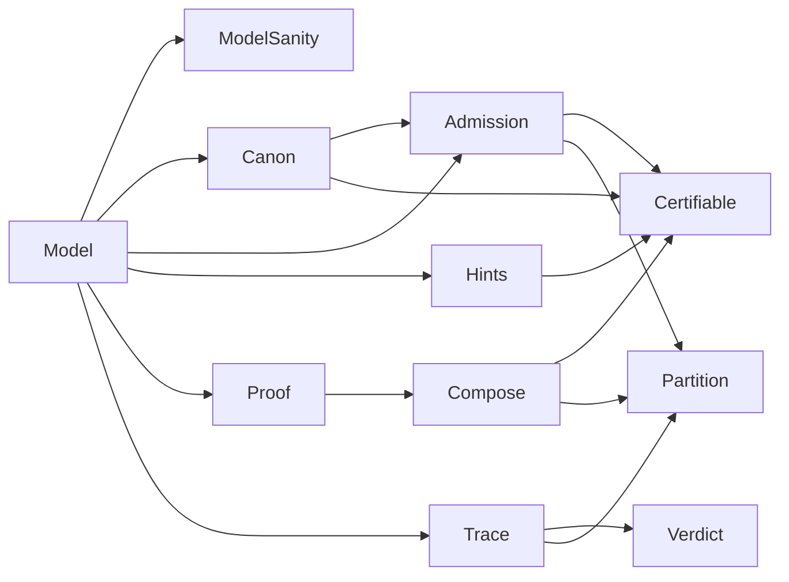

`ci/lean` builds every file except `Partition.lean` and fails on `sorry` or on any axiom outside `propext`, `Classical.choice` and `Quot.sound` in `#print axioms` of each named theorem. It also checks the import closure of `Verdict.lean`: it must not contain `Admission`, `Canon`, `Hints`, `Compose`, `Partition` or `Certifiable`, so `verdict_sound` depends only on its four named hypotheses (P7.1.2). `ci/lean-partition` builds `Partition.lean` with the same checks, so `ci/lean` does not depend on R3.5.

### TLA+ (`verification/tla/`)

- `Coordinator.tla` models Front_End, Coordinator, Workers, the network as a bag of messages, Races, certification as abstract deadlines and outcomes, Certificate_Store completion, fallback, operator actions and the fault actions of R1.6, and includes `Sharing.tla` through `INSTANCE` under `SharingEnabled`. Its invariants and temporal properties are the ones the Verification subsections of R1.2, R1.5 to R1.7, R2.2, R5.1 and R5.4 name, for example `NoEscalationAfterLocalProof`, `AtMostOneVerdict`, `NonRaceProofRecorded`, `CertifiedHasStoredEntry`, and `EventualVerdict` under F1 to F4.
- `Sharing.tla` models export, pool storage, forwarding, admission as an abstract predicate, the pending queue, delivery, Job registration and Lemma_Pool restarts, with P3.1.1, P3.1.2, P3.1.5, P3.1.8, P4.2.1 and P4.2.2 as invariants and P3.1.10 under F1 to F3.
- `traces/CoordinatorTrace.tla` and `actions.toml` implement trace validation (Architecture).
- Bounds are `<TBD-4>`; configurations live next to each specification.

### Creusot and Kani on dp-core

- Creusot (dogfooding) verifies the contracts that the Verification subsections name on the dp-core modules of the module table. Logic functions in the contracts mirror the Lean reference definitions, and the differential tests compare the executable Rust with the compiled Lean references, so a mismatch between the two specifications shows up as a test failure. `ci/creusot` proves dp-core with the legacy configuration, that is, unmodified pinned why3find, so the verification of the backend never depends on the backend.
- Kani harnesses: `calibration.rs` (P1.4.3), `coordinator.rs` (P1.5.1 and P1.5.6 on single transitions), `parsers.rs` (no panic in the Lemma and hint parsers), `pool.rs` (P3.6.1 bounds), `cache_key.rs` (`encode_key` injectivity). Kani also serves as the equivalence artifact of mutation exclusions (R7.13).

### A3 per-run checks

| Check | Where | Requirements | Jobs exercising it |
|---|---|---|---|
| Canonical-input check of Result messages, cache entries, Lock_File, `proof.json` fields | `crates/dp-formats/src/canonical_check.rs` | R7.10 criterion 8 | `ci/sim`, `ci/canaries`, `ci/replay` |
| Task_Hash from `print_local`, task count, Partition_Assumptions, signature, registry, revocation, import-set hash | `crates/dp-frontend/src/accept.rs` | R1.3, R1.7 criterion 6, R3.5 criteria 4 and 5 | `ci/sim`, `ci/canaries` |
| Re-admission pass with local Canonical_Names and recomputed instances | `crates/dp-frontend/src/accept.rs` | R3.4 criterion 9, R4.1 criterion 14, R4.4 criterion 15 | `ci/certs`, `ci/canaries` |
| Re-labelling of every cache hit, with a checker run for certified hits | `accept.rs`, `crates/dp-cert/src/check.rs` | R7.1 criterion 6, R7.5 | `ci/sim`, `ci/certs` |
| Certificate_Checker against `print_local(B)` with all binding checks | `crates/dp-cert/src/check.rs` | R5.3, R3.2, R3.3, R4.1, R4.3, R4.4, R5.1, R5.2, R5.5, R7.10 | `ci/certs`, `ci/canaries` |
| Offline replay | `crates/dp-replay/` | R7.6, R7.2 | `ci/replay` |
| Re-validation of every canary witness and Lemma-canary model | `tests/canaries/witness.rs` | R7.4 | `ci/canaries` |

### A4 harnesses

- **Property tests** use proptest in each crate's `tests/` directory (Testing Strategy).
- **Differential tests** in `tests/diff/`: distributed against local, sharing on against off (within-goal, cross-goal, hints), certify-all on against off, cache on against off, legacy compatibility and legacy reader against unmodified pinned why3find, canonicalization equisatisfiability and determinism, solver names, exported text against why3find, SMT-LIB term parsers against cvc5's parser, and the Lean references against Rust for `admit`, `admit_hint` with `instantiate`, `canon`, `compose_plan` and `label`.
- **Deterministic simulation** in `tests/sim/` (Architecture), seeds `<TBD-13>` per run.
- **Integration** in `tests/integration/`: a local cluster of containers built by Nix (one Coordinator, one Lemma_Pool, at least two Workers), with stub solvers that ignore termination and start child processes, stub checkers, and real cvc5, Ethos and Carcara in `tests/integration/certs/`.
- **Canaries** in `tests/canaries/` (C18), **fuzzing** in `fuzz/` with cargo-fuzz, **mutation testing** in `tools/mutants/` with cargo-mutants.

### A5 pipeline

`eval/scripts/` runs the corpus hardness measurement and RQ1 to RQ7 under the protocol of R6.3; `eval/report/` regenerates the report from committed raw data. `ci/eval-smoke` runs every script once on the CI corpus with the smoke flag; `ci/eval-report` checks committed raw data and the report; `sched/eval` produces the numbers.

### CI job graph

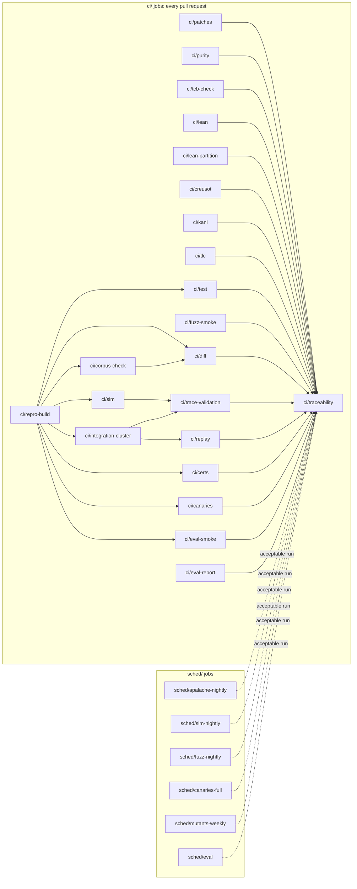

`ci/traceability` starts after every other `ci/` job has ended (R7.11 criterion 9) and reads the most recent acceptable run of each scheduled job (R7.11 criterion 3). The CI system is GitHub Actions (D-15); any system that reports job outcomes and run commits correctly (TB-18) and supports job dependencies and schedules would do.

| Job | Gates |
|---|---|
| `ci/repro-build` | two clean Nix builds with equal hashes; Lock_File schema; upstream checksum or double rebuild of Unpatched_Solvers and checkers (R7.7) |
| `ci/patches` | `patches/` apply, build, header, size, hash, Unpatched_Solver marks (R7.7, R7.9) |
| `ci/purity` | dp-core purity and registry (R7.3) |
| `ci/tcb-check` | `docs/tcb.toml` and `docs/tcb.md` (R7.8) |
| `ci/lean`, `ci/lean-partition` | `proofs/lean/DP/` without `sorry` or extra axioms; `Verdict.lean` import discipline |
| `ci/creusot` | dp-core contracts, `decode_label` |
| `ci/kani` | `verification/kani/` |
| `ci/tlc` | `Coordinator.tla`, `Sharing.tla` at `<TBD-4>` |
| `ci/test` | unit and property tests of every crate, configuration and table-agreement tests |
| `ci/fuzz-smoke` | every target in `fuzz/` for a short run |
| `ci/diff` | `tests/diff/` on the CI corpus |
| `ci/sim` | `tests/sim/` with `<TBD-13>` seeds; writes traces |
| `ci/integration-cluster` | `tests/integration/` except `certs/`; writes traces and Sessions for replay |
| `ci/trace-validation` | traces of `ci/sim` and `ci/integration-cluster` against `Coordinator.tla` |
| `ci/replay` | `tests/replay/` on Sessions of `ci/integration-cluster`, without network |
| `ci/certs` | `tests/certs/`, `tests/integration/certs/` with real cvc5, Ethos and Carcara |
| `ci/canaries` | `tests/canaries/` in every implemented mode |
| `ci/corpus-check` | `eval/corpus/tests/` |
| `ci/eval-smoke`, `ci/eval-report` | `eval/tests/`, `eval/report/check/` |
| `sched/apalache-nightly`, `sched/sim-nightly`, `sched/fuzz-nightly`, `sched/canaries-full`, `sched/mutants-weekly`, `sched/eval` | larger bounds, longer simulations, `<TBD-24>` fuzzing, full-corpus canaries, mutation testing, evaluation |
| `ci/traceability` | terminal job (R7.11) |

## Correctness Properties

*A property is a characteristic or behavior that should hold true across all valid executions of a system-essentially, a formal statement about what the system should do. Properties serve as the bridge between human-readable specifications and machine-verifiable correctness guarantees.*

The properties below consolidate the P-IDs of `requirements.md` after the prework analysis and property reflection: properties with the same shape (fail-closed configuration, discard as a no-op, round trips, on-off differentials) are merged, and each design property covers a distinct set of requirements. The P-IDs remain the unit of the Traceability_Table; each design property lists the P-IDs it covers, its verification, and the requirements it validates. Every P-ID of `requirements.md` is covered by at least one design property.

Each property ends with two references. *Requirement IDs* lists the R-IDs it validates. The **Validates** line uses the spec tooling's numbering of `requirements.md`: `N.c` is acceptance criterion c of the heading "Requirement N" (for example, 30.2 is R7.1 criterion 2 and 9.8 is R2.2 criterion 8). A requirement listed by R-ID without criteria in the Validates line is validated through a P-ID that is not tied to one criterion (for example P1.6.3 or P7.1.8).

R-ID to tooling number: R1.1 to R1.7 are 1 to 7; R2.1 to R2.3 are 8 to 10; R3.1 to R3.6 are 11 to 16; R4.1 to R4.4 are 17 to 20; R5.1 to R5.5 are 21 to 25; R6.1 to R6.4 are 26 to 29; R7.1 to R7.13 are 30 to 42.

### Property 1: Proof labels come only from the two routes

*For any* Session, configuration (legacy or not, certify-all on or off), fault schedule and adversarial Coordinator schedule, and any Result r: `label(r) = proved-standalone` exactly when every condition of R7.1 criterion 2 holds; a Result that needs certification gets only certified, checked-incomplete or unchecked, and certified only with an accepting pinned-checker run against `print_local(G)` whose binding checks pass and a complete Certificate_Store entry, both by r's certification deadline; every proof-labelled Verdict is recorded from such a Result; with certify-all on every proof label is certified; in the legacy configuration every proof label is proved-standalone.

Covers P7.1.1, P7.1.3, P7.1.5, P5.1.6, P5.3.6, P5.5.1, P5.5.2, P5.5.3, P1.6.3, P2.2.5, P7.12.2. Verification: A1 Creusot on `label` and `record_verdict` (`crates/dp-core/src/verdict.rs`, `ci/creusot`); A3 `accept.rs` and `check.rs`; A4 `prop_verdict.rs`, `label_lean_vs_rust/`, `tests/sim/adversarial_coordinator.rs`, mutation testing.

Requirement IDs: R7.1, R5.1, R5.3, R5.5, R7.12, R2.2, R1.6.

**Validates: Requirements 30.1, 30.2, 30.3, 30.4, 30.5, 21.8, 23.4, 23.17, 25.1, 25.2, 25.3, 41.2, 9.8, 9.10**

### Property 2: Verdict soundness in the Lean trace model

*For any* trace of the Lean trace model and any Verdict v of Goal_Version G: if `v.label = proved-standalone`, the Assertions of `print_local(G)` are unsatisfiable under `SolverSound`, `WorkerHonest` and `NoCollision`; if `v.label = certified`, they are unsatisfiable under `CheckerSound` and `NoCollision` alone; and, in the extended model, the same holds for a certified Verdict recorded from a leaf-Result set.

Covers P7.1.2, P3.5.9. Verification: A1 `proofs/lean/DP/Verdict.lean` (`ci/lean`, with the import-closure check) and `Partition.lean` (`ci/lean-partition`).

Requirement IDs: R7.1, R3.5.

**Validates: Requirements 30.1, 30.2, 30.3, 15.2**

### Property 3: Accepted Results are bound to the local print, the submission and an authentic Worker

*For any* message schedule of an adversarial Coordinator or network and any Result r that the Verdict_Recorder accepts for G: r's Task_Hash equals the hash of `print_local` with r's Driver and Transformation_Pipeline plus the recorded Partition_Assumptions of r's Partition, that pipeline yields exactly one task, the pair of goal path and Solver_Configuration was submitted in the Session, r's tag verifies under the registered, unrevoked key of r's Worker in the Front_End's operator-signed view, the import-set hash matches the import list, and a Partition Result uses the recorded tree's Driver and pipeline; a solver binary hash outside `unpatched(Lock_File)` makes r a Lemma_Dependent_Result; any change to one field of an authentic Result, and any tag produced by another Worker for r's Worker identity, is rejected.

Covers P1.3.1, P1.3.2, P1.3.3, P1.3.5 to P1.3.10, P1.7.2, P2.1.2, P2.1.5, P3.5.3, P3.5.8, P7.1.7. Verification: A1 Creusot on `accept_result`; A3 `crates/dp-frontend/src/accept.rs`; A4 `prop_accept.rs`, `fuzz/result_message/`, `tests/sim/adversarial_coordinator.rs`, `tests/sim/lying_provenance.rs`, pipeline canaries, mutation testing.

Requirement IDs: R1.3, R1.7, R2.1, R3.5, R7.1.

**Validates: Requirements 3.1, 3.2, 3.3, 3.4, 3.5, 3.6, 3.7, 3.9, 3.10, 7.6, 8.6, 15.4, 15.5, 15.9, 30.7**

### Property 4: Discards are no-ops and handlers are idempotent

*For any* component among Coordinator, Worker, Verdict_Recorder, Lemma_Pool, Certificate_Store and the operator-command handler, any state s and any input m: if the component discards m, the next state equals s except for one log entry; delivering m any positive number of times has the effect of delivering it once; of two messages with one identifier the first wins; inserting a pool item or storing an entry twice equals doing it once; repeating a drain or revoke command changes nothing; and a cancellation for a Job that is not running leaves the Worker unchanged except for its not-running report.

Covers P1.3.4, P1.5.9, P1.6.2, P1.6.8, P1.7.7, P1.7.8, P3.1.6, P3.6.2, P3.6.3, P3.6.4, P5.4.4. Verification: A2 `Coordinator.tla` first-wins invariant (`ci/tlc`); A4 `prop_idempotent.rs`, `prop_cancel.rs`, `prop_operator.rs`, `prop_forward.rs`, `prop_pool.rs`, `prop_store.rs`.

Requirement IDs: R1.3, R1.5, R1.6, R1.7, R3.1, R3.6, R5.4.

**Validates: Requirements 3.4, 3.8, 5.6, 6.11, 6.12, 6.13, 7.3, 7.5, 7.10, 7.11, 11.7, 11.8, 16.2, 16.3, 16.4, 16.5, 16.6, 24.5**

### Property 5: Invalid configurations and pin mismatches fail closed

*For any* project state and any configuration value that R1.1 criterion 6, R1.2 criterion 7, R1.6 criterion 7, R2.1 criteria 3 to 5, R2.2 criterion 17, R4.2 criterion 8 or R5.5 criterion 5 rejects, and any Session start at which a local executable's hash differs from its Lock_File entry or has none: the prove command starts no solver process, reports the offending value, exits with a non-zero status and leaves `proof.json` and `.why3find` byte-identical; and every accepted configuration, including the default one, satisfies the heartbeat margin of R1.6 criterion 18 and has Portfolios that are non-empty, duplicate-free and free of splitting transformations.

Covers P1.1.6, P1.2.6, P1.6.9, P1.6.15, P2.1.3, P2.1.4, P2.2.13, P4.2.6, P5.5.6, P7.7.2. Verification: A4 `crates/dp-formats/tests/prop_config.rs`, `crates/dp-core/tests/heartbeat_margin.rs` (`ci/test`), `tests/integration/config/`, `tests/integration/cluster/config.rs`, `tests/integration/pins/` (`ci/integration-cluster`).

Requirement IDs: R1.1, R1.2, R1.6, R2.1, R2.2, R4.2, R5.5, R7.7.

**Validates: Requirements 1.6, 2.7, 6.7, 6.18, 8.3, 8.4, 8.5, 9.17, 18.8, 25.5, 36.3**

### Property 6: Easy goals stay local

*For any* Session trace, with certify-all on or off: a Goal_Version with a proof-labelled cache hit, or with a Local_Fast_Pass Result labelled proved-standalone (or certified locally in certify-all mode), is never submitted to the Cluster; every submitted Goal_Version completed its Local_Fast_Pass without such a Result first; every started Goal_Version is in exactly one of the three classes of P1.2.4; and every Local_Fast_Pass solver process starts with a time limit no greater than the budget.

Covers P1.2.1 to P1.2.5, P1.2.7. Verification: A1 Creusot on `escalation.rs`; A2 `NoEscalationAfterLocalProof`, `FastPassBeforeSubmission`, `CacheHitStaysLocal` (`ci/tlc`); A4 `prop_escalation.rs`, `tests/sim/`, `tests/integration/fast_pass/`; A5 RQ7.

Requirement IDs: R1.2.

**Validates: Requirements 2.1, 2.2, 2.3, 2.4, 2.6, 2.8, 2.9**

### Property 7: Races decide by their first proof label

*For any* Race and any arrival order of its Results and reports: its whole-Goal_Version Jobs are one per configuration-list entry plus one replacement per incarnation change, submitted in Race order with at most `<TBD-8>` open and at most one open per entry; the winner is the first Result to receive a proof label and the Race ends at that step; without a winner the Race ends only when no Result awaits certification, or by the stop policy, the fallback or the per-goal deadline, and the Verdict is the most informative non-proof outcome; under the policy `continue` whether the Verdict is proof-labelled does not depend on arrival order; Results after the end change no Verdict and, if they need certification, are unchecked without proof or checker runs; a proof label together with an accepted Invalid Result produces a conflict entry; every Escalated_Goal is classified exactly once when portfolio racing and the cluster option are on, and none otherwise; no Job is submitted after the Race deadline; and a single Partition Result never wins.

Covers P2.2.1 to P2.2.5, P2.2.7 to P2.2.12, P2.2.14 to P2.2.19, P1.6.13, P3.5.5. Verification: A1 Creusot on `race.rs`; A2 Race actions of `Coordinator.tla` (`ci/tlc`, `sched/apalache-nightly`); A4 `prop_race.rs`, `tests/sim/`, `tests/sim/faults/`, `tests/integration/cluster/race.rs`.

Requirement IDs: R2.2, R1.6, R3.5.

**Validates: Requirements 9.1, 9.2, 9.3, 9.4, 9.5, 9.6, 9.7, 9.8, 9.9, 9.10, 9.11, 9.12, 9.13, 9.14, 9.15, 9.16, 9.18, 9.19, 9.20, 9.21, 9.22, 9.23, 9.24, 9.25, 9.26, 9.27, 6.8, 15.7, 15.8**

### Property 8: Coordinator protocol safety

*For any* behavior of `Coordinator.tla` within `<TBD-4>` and any simulation trace in the fault model: each Goal_Version has at most one Verdict per Session and it never changes; the final `proof.json` write happens only when every started Goal_Version has a Verdict; a proof label assigned outside a Race is recorded as the Verdict; a Job is assigned only to an eligible Worker whose latest offer has the Job's prover and version with a Lock_File hash and a positive finite Calibration, with local limit `scale(cal, reference)` computed without overflow and monotone; an unassignable Job stays queued and is reported; a Job identifier is assigned at most `1 + <TBD-6>` times; heartbeat timeout, reconnect and revocation fail the Worker's running Jobs; a drained Worker gets no new Job until re-registered and keeps its running Jobs; the eligible set equals its definition; cancellations touch only Jobs of the named Session and Goal_Version and cancelled reports reach that Session; unknown running Jobs are cancelled; a silent Session's Jobs are dropped; status reports are complete; and a refused connection records no offer.

Covers P1.1.2, P1.1.7, P1.4.1, P1.4.2, P1.4.3, P1.4.6, P1.5.1, P1.5.2, P1.5.6, P1.5.10 to P1.5.13, P1.6.4, P1.6.5, P1.6.10, P1.6.11, P1.6.14, P1.7.1, P1.7.3 to P1.7.6, P1.7.9. Verification: A2 TLC and Apalache on `Coordinator.tla`, Kani `verification/kani/coordinator.rs` and `calibration.rs`; A4 `prop_assign.rs`, `prop_operator.rs`, `prop_calibration.rs`, `prop_record.rs`, `tests/sim/`.

Requirement IDs: R1.1, R1.4, R1.5, R1.6, R1.7.

**Validates: Requirements 1.3, 1.4, 1.7, 4.1, 4.3, 4.4, 5.1, 5.2, 5.3, 5.4, 5.7, 5.8, 5.13, 5.14, 5.15, 5.16, 6.1, 6.2, 6.3, 6.10, 6.16, 6.17, 7.1, 7.2, 7.3, 7.4, 7.5, 7.7, 7.8, 7.9**

### Property 9: Every Escalated_Goal gets a Verdict in bounded time

*For any* trace: under F1 to F4 every started Goal_Version eventually gets a Verdict and every Job of a Goal_Version with a Verdict stops; with F3 alone, whatever the Coordinator, network and Workers do, every Escalated_Goal gets a Verdict within `<TBD-3>` of escalation; under F1 to F4 with certification within its budgets every Race ends within `<TBD-9> + <TBD-14> + <TBD-15>`; an escalated Goal_Version is submitted once the Front_End is connected unless it gets a Verdict, its deadline passes or the connection is lost first; after a switch to the fallback there is no Cluster submission and the configured fallback decides every Escalated_Goal; after an incarnation change the replacement Jobs are submitted; finite fault schedules, including Lemma_Pool faults, end with exactly one Verdict per Goal_Version; and a Lemma_Pool that follows `Sharing.tla` forwards every pool item within `<TBD-43>` under F1 to F3.

Covers P1.1.1, P1.1.5, P1.5.3, P1.5.4, P1.5.7, P1.6.1, P1.6.6, P1.6.7, P2.2.6, P3.1.7, P3.1.10. Verification: A2 liveness checks of `Coordinator.tla` and `Sharing.tla` (`ci/tlc`, `sched/apalache-nightly`); A4 `tests/sim/` with silent and adversarial Coordinators, `tests/sim/forwarding.rs`, `tests/integration/cluster/faults.rs`, `fallback.rs`.

Requirement IDs: R1.1, R1.5, R1.6, R2.2, R3.1.

**Validates: Requirements 1.1, 1.5, 5.9, 6.4, 6.5, 6.6, 6.9, 6.20, 9.13, 11.9, 11.11**

### Property 10: Implementation traces are behaviors of the specification

*For any* run of `ci/sim` and `ci/integration-cluster`: the run produces at least one trace, every record names an action listed in `verification/tla/actions.toml`, and the merged traces are a behavior of `Init ∧ □[Next]_vars` of `Coordinator.tla`.

Covers P1.5.5. Verification: A2 `verification/tla/traces/` (`ci/trace-validation`).

Requirement IDs: R1.5.

**Validates: Requirements 5.10, 5.11, 5.12**

### Property 11: Process trees end and heartbeats flow within their bounds

*For any* Job whose local limit expires at time t or that receives a cancellation at t, its solver process tree is gone by `t + <TBD-33>` or `t + <TBD-2>` respectively and the matching report follows; for any Verdict recorded at the per-goal deadline at t, the Goal_Version's local process trees are gone by `t + <TBD-45>`; for any checker run still running at the certification deadline, its process tree is killed then and the Result is unchecked; and consecutive heartbeats of a connected Worker, a Front_End with an open Cluster submission and a Coordinator holding a Session's Jobs are at most `<TBD-31>` apart.

Covers P1.4.5, P1.5.8, P1.5.14, P1.6.12, P5.3.9. Verification: A4 `tests/integration/cluster/cancel.rs`, `deadline.rs`, `calibration.rs` (`ci/integration-cluster`), `tests/integration/certs/` (`ci/certs`), `tests/sim/`.

Requirement IDs: R1.4, R1.5, R1.6, R5.3.

**Validates: Requirements 4.5, 5.5, 5.17, 6.14, 6.15, 6.19, 23.10**

### Property 12: Admitted Lemmas follow from the target problem (metatheory)

*For any* source Job a and target Job b, Lemma L and Dependency_Set Δ ⊆ Γ_a with `Δ ⊨ L` in Σ_A: if `admit(L, Δ, b)` holds, then `Γ_b ⊨ L` in Σ_B, also when Γ_b and Δ contain quantified formulas and across Goal_Versions whose Canonical_Names satisfy `canon_injective`; for any sequence of admitted or exported Lemmas whose used Lemmas precede them, `Γ_b` entails each; for any Result whose imports passed the re-admission pass and whose `compose_plan` succeeded with valid Lemma entailments, the composed derivation's open assumptions lie in Γ_b; and the Lean model distinguishes defined symbols with different bodies and leaves division by zero unspecified.

Covers P3.4.1, P3.4.5, P3.4.12, P4.2.5, P4.3.2, P7.1.8. Verification: A1 `proofs/lean/DP/Admission.lean`, `ModelSanity.lean`, `Certifiable.lean` (`ci/lean`).

Requirement IDs: R3.4, R4.2, R4.3, R7.1.

**Validates: Requirements 14.1, 14.2, 14.8, 18.5, 19.1, 19.4**

### Property 13: The admission procedure is the specified function

*For any* Lemma L and target Job t: the Rust `admit(L, t)` and its logged reason category equal the Lean reference; a rejection logs the first failing check in the order of R3.4 criterion 6; L is admitted when every check passes, including when it contains ground terms absent from t's Assertions and when t has quantified Assertions; admission is monotone in the target problem; and L is rejected when Driver, pipeline or logic differ, a used Lemma is neither admitted into nor exported by t, a Partition_Assumption of its Dependency_Set is not t's, its negated-goal flag is set and its source Goal_Version differs from t's (even with equal goal path and base Task_Hash), or t's Printed_Goal has a canonicalization failure.

Covers P3.4.2, P3.4.3, P3.4.4, P3.4.6 to P3.4.9, P3.4.11, P3.4.13, P4.1.10, P4.2.4, P4.3.3, P4.3.5. Verification: A1 Creusot on `admit` (`crates/dp-core/src/admission.rs`); A4 `tests/diff/admission_lean_vs_rust/`, `prop_admission.rs`, `prop_scope.rs`, `prop_ground.rs`, Lemma canaries, mutation testing.

Requirement IDs: R3.4, R4.1, R4.2, R4.3.

**Validates: Requirements 14.1, 14.2, 14.3, 14.4, 14.5, 14.6, 14.7, 14.8, 14.11, 17.12, 18.5, 18.6, 19.1, 19.4**

### Property 14: Admitted Lemmas are hygienic

*For any* byte string b and target T: the Lemma parser terminates without panic; an admitted Lemma is closed, binder-free, annotation-free, well-sorted of sort Bool and mentions only symbols of `CV(T) ∪ theory(logic(T))`; a Lemma that mentions any other symbol, including a solver-introduced name, is rejected with hygiene and the log lists exactly the foreign symbols; a Lemma over the size limit is rejected as malformed without parsing; well-formed Lemmas round-trip; hygiene is monotone in the vocabulary; and the Worker's export filters drop exactly the Lemmas with foreign symbols, binders, annotations or free variables.

Covers P3.3.1 to P3.3.6, P4.3.1, P4.3.4, P4.3.6, P3.1.9. Verification: A1 Creusot on `hygiene_ok` and `is_ground_lemma`; A2 Kani `parsers.rs`; A3 re-admission and checker re-parse; A4 `prop_hygiene.rs`, `prop_ground.rs`, `fuzz/lemma_parser/`, mutation testing.

Requirement IDs: R3.3, R4.3, R3.1.

**Validates: Requirements 13.1, 13.2, 13.3, 13.4, 13.5, 13.6, 19.2, 19.3, 19.5, 11.1**

### Property 15: Provenance is well-formed, authentic and preserved

*For any* Lemma or Instantiation_Hint that the Admission_Checker admits: its Provenance_Record parses with every field, its negated-goal flag agrees with its Dependency_Set (and is false with Dependency_Set {n} for a hint), its identifier is the hash over the received bytes, and its tag verifies under the registered, unrevoked key of its Worker; any change to text, identifier or a provenance field is rejected; without solver-reported dependencies the default Dependency_Set and used Lemmas, hints included, are recorded; the admitted-Lemma graph of each Job is acyclic; the Lemma_Pool returns stored bytes unchanged; and the Certificate_Store entry of every certified or checked-incomplete Result holds its target proof, its Lemma proofs, the Provenance_Record of every element of `imports*`, and the audit records of the hints' used Lemmas.

Covers P3.2.1, P3.2.3, P3.2.4, P3.2.6 to P3.2.9, P4.4.5, P4.4.6, P4.4.12, P5.4.3, P5.1.1. Verification: A1 Creusot on `provenance.rs`; A3 checker runs; A4 `prop_provenance.rs`, `prop_admission.rs`, `crates/dp-pool/tests/prop_pool.rs`, `fuzz/provenance/`, audit-trail checks in `tests/replay/`.

Requirement IDs: R3.2, R4.4, R5.4, R5.1.

**Validates: Requirements 12.1, 12.2, 12.3, 12.4, 12.5, 12.6, 12.7, 12.10, 20.2, 20.3, 20.5, 20.7, 20.8, 20.19, 24.1, 21.1, 21.2**

### Property 16: Canonical names mean identical declarations

*For any* Printed_Goals P and Q, canonicalized in any processes, on any machines and with any hash seeds: equal Canonical_Names imply equal kind, Driver and Transformation_Pipeline and identical declarations or canonical formulas, and identical declarations or canonical formulas imply equal names (a symmetric relation); names are invariant under bound-variable renaming and normalization is idempotent; P is equisatisfiable with its canonical form; the assignment is deterministic and equals the Lean reference; every name matches the Canonical_Name grammar, whose language is disjoint from SMT-LIB reserved words, theory symbols and every solver-introduced name pattern, and no source name of the CI corpus matches such a pattern; a Printed_Goal without exactly one goal-marker Assertion is a failure; Negated_Goal_Assertion names differ across goal paths and base Task_Hashes; collisions under a weak test hash are reported; label references are inlined; and the Canonicalizer terminates without panic on every byte string.

Covers P4.1.1 to P4.1.9, P4.1.11, P4.1.14, P4.1.15, P4.1.16, P4.1.19, P4.1.20. Verification: A1 `proofs/lean/DP/Canon.lean`; A4 `crates/dp-canon/tests/`, `tests/diff/canon_equisat/`, `canon_determinism/`, `canon_lean_vs_rust/`, `solver_names/`, `fuzz/canonicalizer/`, mutation testing.

Requirement IDs: R4.1.

**Validates: Requirements 17.1, 17.2, 17.3, 17.4, 17.5, 17.6, 17.7, 17.8, 17.9, 17.10, 17.11, 17.15**

### Property 17: Certification inputs are re-derived locally

*For any* Result r of Goal_Version B that needs certification, whatever Canonical_Names, instances and formulas the Workers, the Coordinator and the Lemma_Pool send: the Canonical_Vocabulary, names and canonical formulas used are those of `canon(print_local(B))`; the extended problem and every Lemma problem are built only from `print_local(B)`, the recorded Partition tree, the imported Lemma texts and the instances that `instantiate` recomputes; `oblig(r)` is the used-Lemma closure of the imports that match open assumptions of the target proof; the leaf-Result set holds the first proof-reporting Result per leaf with the tree's Driver and pipeline; and a certified r passed one re-admission pass over its whole import list in order.

Covers P4.1.12, P3.4.10, P4.4.9, P5.1.4, P5.1.7, P5.1.9, P5.1.11. Verification: A1 Creusot on `certification.rs`; A3 `accept.rs`; A4 `prop_certification.rs`, `tests/sim/lying_provenance.rs`, `tests/integration/certs/`.

Requirement IDs: R4.1, R3.4, R4.4, R5.1.

**Validates: Requirements 17.14, 14.9, 14.10, 20.15, 20.16, 21.1, 21.2, 21.3, 21.10**

### Property 18: Renaming between source names and Canonical_Names round-trips

*For any* Printed_Goal P without canonicalization failure: renaming a term over P's source names to Canonical_Names and back gives the term, and the converse holds for terms over `CV(P)`; any Lemma or hint with a symbol outside the name map and the theory symbols is dropped, never sent, and logged with exactly its unmapped symbols; and the SMT-LIB script parser round-trips.

Covers P4.1.13, P4.1.17, P4.1.18. Verification: A4 `crates/dp-canon/tests/`, `crates/dp-worker/tests/prop_rename.rs`.

Requirement IDs: R4.1.

**Validates: Requirements 17.16, 17.17, 17.18, 17.19**

### Property 19: Instantiation_Hints yield only entailed instances

*For any* Γ_B with a universally quantified Hypothesis h and closed, well-sorted terms t̄ of matching sorts: `Γ_B ⊨ φ_h[t̄/x̄]`; `instantiate` returns that simultaneous substitution as a closed Bool term without the top-level patterns and non-pattern attributes and with nested patterns kept; `admit_hint` rejects with the first failing check of R4.4 criterion 9, admits every hint that passes them, and equals the Lean reference together with `instantiate`; the Worker's export filter drops exactly the hints with offending terms; hints round-trip; and certificates print instance conclusions in the form the pinned checkers derive, which they accept.

Covers P4.4.1 to P4.4.4, P4.4.7, P4.4.8, P4.4.10, P4.4.11, P4.4.13. Verification: A1 `proofs/lean/DP/Hints.lean`, Creusot on `hints.rs`; A2 Kani `parsers.rs`; A4 `prop_hints.rs`, `tests/diff/hints_lean_vs_rust/`, hint canaries, `tests/integration/certs/`.

Requirement IDs: R4.4.

**Validates: Requirements 20.1, 20.4, 20.9, 20.10, 20.11, 20.12, 20.13, 20.14, 20.17, 20.18, 20.20**

### Property 20: Lemmas flow only within their scope

*For any* pool item that the Lemma_Pool forwards from Job a to Job b: a and b differ and share the Session, b carries the import mark, and either both have the same Goal_Version and base Task_Hash, or cross-goal sharing is on and they have equal sibling group, Driver and pipeline hashes and the item's negated-goal flag is clear; every Result of an import-marked Job or of a Job with deliveries is a Lemma_Dependent_Result; each delivery follows an admission and is recorded before the solver sees it; every Result's import list contains all earlier deliveries; Workers send the registration and end messages of R3.1; and each cross-goal admission decision is logged once.

Covers P3.1.1, P3.1.2, P3.1.4, P3.1.5, P3.1.8, P3.1.11, P4.2.1, P4.2.2, P4.2.7. Verification: A2 `Sharing.tla` (`ci/tlc`); A4 `prop_forward.rs`, `prop_scope.rs`, `tests/sim/forwarding.rs`.

Requirement IDs: R3.1, R4.2, R4.4.

**Validates: Requirements 11.3, 11.4, 11.5, 11.6, 11.10, 11.12, 11.13, 18.2, 18.3, 18.4, 18.7, 20.6**

### Property 21: The pending queue is bounded and drains

*For any* Worker trace and Job b: b's pending queue holds at most `<TBD-42>` Lemmas; a Lemma enters only after a used-Lemma-order rejection; it is re-checked whenever one of its used Lemmas arrives, and leaves within `<TBD-41>` either delivered after admission or with a logged rejection; and in the two-Job default-Dependency_Set scenario no Lemma is rejected for used-Lemma order under any reordering, delay, duplication or Lemma_Pool restart.

Covers P3.1.12, P3.1.13, P3.1.14. Verification: A4 `prop_pending.rs`, `tests/sim/two_job_default_deps.rs`.

Requirement IDs: R3.1.

**Validates: Requirements 11.14, 11.15, 11.16, 11.17**

### Property 22: The Lemma_Pool stays within its bounds

*For any* sequence of input byte strings: the Lemma_Pool handles every request without crashing; after each request every pair of Session and Goal_Version has at most `<TBD-11>` items, every stored Lemma at most `<TBD-12>` bytes, every stored hint at most `<TBD-35>` bytes, and the total at most `<TBD-34>` bytes; a Session-end or Session-drop removes exactly that Session's items; and the pool is empty right after a restart.

Covers P3.6.1, P3.6.5, P3.6.6. Verification: A2 Kani `verification/kani/pool.rs`; A4 `prop_pool.rs`, `fuzz/lemma_pool_ingest/`, `tests/sim/hostile_pool.rs`.

Requirement IDs: R3.6.

**Validates: Requirements 16.1, 16.2, 16.3, 16.4, 16.7, 16.8**

### Property 23: Missing, late or unstored certification gives unchecked

*For any* Result r that needs certification: if a target proof or a Lemma proof is missing at the proof deadline, an identifier of `imports*(r)` cannot be resolved, or the Certificate_Store fails to store r's entry, then `label(r) = unchecked`; r is labelled no later than its certification start plus `<TBD-14> + <TBD-15>`, with the certification start of R5.1 (including cache entries, counted from their read); an r accepted after its Race ended or after its certification deadline is unchecked at acceptance with no proof or checker run; and at the proof deadline every proof run and composition for r stops and later proofs are ignored.

Covers P5.1.2, P5.1.3, P5.1.5, P5.1.8, P5.1.10, P5.4.6. Verification: A1 Creusot on `certification.rs`; A2 certification deadlines in `Coordinator.tla`; A4 `prop_certification.rs`, `tests/sim/`, `tests/integration/certs/`, `store_faults.rs`.

Requirement IDs: R5.1, R5.4, R2.2.

**Validates: Requirements 21.4, 21.5, 21.6, 21.7, 21.9, 24.6, 9.26**

### Property 24: Composed certificates follow the plan and derive false from B's Assertions

*For any* Result r and Composed_Certificate C produced for it: in the Lean model, composing valid sub-derivations under the plan's rules gives a derivation of false from Γ_B; `open(C)` is contained in the Assertions of `print_local(B)`; every open assumption of each Lemma sub-proof is allowed by (a), (b) or (c) of R5.2 criterion 5; every hint instance is justified by a preceding universal-instantiation step equal as an instance to `instantiate`'s result; `input(C) = print_local(B)` byte for byte; each Lemma sub-proof closes its refutation by a scope step and a contradiction or double-negation step; matching is equality of canonical printed forms after symbol mapping; every abort reason of R5.2 gives unchecked; and the Rust `compose_plan` equals the Lean reference.

Covers P5.2.1 to P5.2.6, P5.2.8, P5.2.12, P5.2.13, P5.2.14, P3.2.2, P3.2.5. Verification: A1 `proofs/lean/DP/Compose.lean`, Creusot on `compose_plan.rs`; A3 checker runs; A4 `crates/dp-cert/tests/prop_compose.rs`, `tests/diff/compose_lean_vs_rust/`, `tests/integration/certs/`, Lemma and certificate canaries.

Requirement IDs: R5.2, R3.2.

**Validates: Requirements 22.1, 22.2, 22.3, 22.4, 22.5, 22.6, 22.7, 22.8, 22.9, 22.13, 22.14, 22.16, 22.17, 22.18, 22.19, 22.20, 12.8, 12.9**

### Property 25: Certificates stay inside the supported fragment

*For any* command list c of a CPC or Alethe proof: `fragment_ok(c)` holds exactly when every command is in its format's allow-list and every rule name is in the pinned rule set; every certificate passed to a checker satisfies `fragment_ok`; a received proof with a banned command aborts composition; and while the Carcara part of AS-6 is To check, an Alethe certificate with a `hole` step or an unpinned rule is unchecked whatever the checker says.

Covers P5.2.11, P5.3.12. Verification: A1 Creusot on `crates/dp-core/src/fragment.rs`; A4 `prop_fragment.rs`, one certificate canary per banned command, the Alethe hole canary.

Requirement IDs: R5.2, R5.3.

**Validates: Requirements 22.15, 22.16, 23.15, 23.19**

### Property 26: Partitioned Goal_Versions are proved only by a checked cover

*For any* Γ_B, Partition tree and leaf derivations: if the leaf cubes cover, unsatisfiable leaves give `Γ_B ⊨ φ`, split trees always cover, and partition composition yields a derivation of false from Γ_B; *for any* partitioned Goal_Version, a proof-labelled Verdict from its leaf Results is certified and rests on a checker accept against `print_local(G)`; a tree whose leaves do not cover yields no such Verdict; and the certificate has one excluded-middle proof per internal node with every partition-dependent Lemma inside the scope of each leaf that needs it.

Covers P3.5.1, P3.5.2, P3.5.4, P3.5.6, P5.2.7, P5.2.15. Verification: A1 `proofs/lean/DP/Partition.lean` (`ci/lean-partition`); A3 `crates/dp-cert/src/partition.rs`; A4 `crates/dp-cert/tests/prop_partition.rs`, `tests/canaries/partition/`.

Requirement IDs: R3.5, R5.2.

**Validates: Requirements 15.2, 15.6, 22.10, 22.11, 22.12, 22.21**

### Property 27: Checker outcomes map to labels by one exact rule

*For any* tuple of checker outcome, elapsed time, binary hash, option list, signature-file hashes, recorded and local Task_Hashes, assumption-check result, fragment and hole results and storage completion step: `label_from_checker_output` returns exactly one of certified, checked-incomplete and unchecked, with certified exactly when the outcome is accept, every binding check passes and both the outcome and storage completion come by the certification deadline; output outside the fixed table is never certified; certificates for another input problem, or run with another option list or signature file, are unchecked; the logged checker identity equals the Lock_File and TCB_Document entries; the label table and option lists agree with `docs/tcb.toml`; and certified is assigned only after the Certificate_Store entry is complete and its content hash is the one written to `proof.json`.

Covers P5.3.1, P5.3.2, P5.3.4, P5.3.5, P5.3.8, P5.3.10, P5.3.11, P5.3.13, P5.4.8, P7.8.5, P7.8.6. Verification: A1 Creusot on `labels.rs`; A2 `CertifiedHasStoredEntry` (`ci/tlc`); A3 `check.rs`; A4 `prop_verdict.rs`, `tests/diff/label_lean_vs_rust/`, `tests/certs/tamper/`, `tests/integration/certs/`, `fuzz/checker_output/`.

Requirement IDs: R5.3, R5.4, R7.8.

**Validates: Requirements 23.1, 23.2, 23.3, 23.4, 23.5, 23.6, 23.7, 23.8, 23.9, 23.11, 23.12, 23.13, 23.14, 23.16, 23.17, 23.18, 24.3, 24.4, 37.3, 37.4**

### Property 28: The Certificate_Store is content-addressed and crash-safe

*For any* entry e: storing e returns the hash of its canonical manifest and reading that hash returns e; e's stored Printed_Goal hashes to `print_local(B)` and its checker identity equals the Lock_File entry; *for any* crash point, every content hash in `proof.json` resolves to a complete entry whose files match the manifest; and any change to an entry or to a content hash in `proof.json` is reported by replay.

Covers P5.4.1, P5.4.2, P5.4.5, P5.4.7. Verification: A4 `crates/dp-cert/tests/prop_store.rs`, `tests/integration/certs/store_faults.rs`, `tests/replay/tamper/`.

Requirement IDs: R5.4.

**Validates: Requirements 24.1, 24.2, 24.5, 24.7, 24.8, 24.9**

### Property 29: Cache hits reuse only what nothing could have changed

*For any* two run descriptions that differ in a lookup field, their encodings differ, and a lookup for one never returns an entry stored for the other, even under a deliberately weak test hash; keys are deterministic, change with the import mark and, for run descriptions that may need certification, with the pinned checker identities, and do not depend on certify-all; an entry whose stored binary hash is not in the current Lock_File (local entries included), whose local limit is not the Calibration scaling, whose import-set hash mismatches, or whose remote Result fails R1.3, is a miss with no Verdict; a hit is labelled as a fresh Result of the current Session, with a checker run for certified hits; in certify-all mode a hit that cannot be labelled certified is a miss; non-proof answers with mismatching limits are not cached; and the legacy layout holds only proved-standalone entries, so unmodified why3find proves no Canary_Goal.

Covers P7.5.1 to P7.5.3, P7.5.5 to P7.5.10, P7.1.6, P5.5.5, P5.5.7, P1.4.4. Verification: A1 Creusot on `cache_key.rs`; A2 Kani `cache_key.rs`; A3 `accept.rs`, `check.rs`; A4 `prop_cache_key.rs`, cache canaries, `tests/diff/legacy_reader/`.

Requirement IDs: R7.5, R7.1, R5.5, R1.4.

**Validates: Requirements 34.1, 34.2, 34.3, 34.4, 34.5, 34.6, 34.7, 34.8, 34.9, 34.10, 34.11, 30.6, 25.4, 25.6, 4.6, 4.7**

### Property 30: proof.json and the Creusot_CLI report labels faithfully

*For any* Verdict v: writing and reading `proof.json` preserves the label, the conflict field, the Invalid field, the replay fields with their absent markers, the import list and hashes, and certificate references that resolve to entries with v's Task_Hash; a proved-standalone Verdict has an empty import list and a non-empty import list implies certified; unmodified why3find reads non-proof entries as not proved and ignores the extension fields; any label string outside the label set decodes to a non-proof outcome; `most_informative` returns the minimum in the information order and ignores input order; `classify` maps every other prover answer to failed, unknown or timeout as why3find does; recorded labels never depend on labels read from `proof.json`; a conflict lists exactly the proof-labelled and Invalid Results and keeps the Verdict; and a Session ending with a conflict whose proof-labelled Result is proved-standalone exits non-zero.

Covers P2.2.9, P2.3.1, P2.3.2, P2.3.3, P2.3.5, P7.2.1 to P7.2.9. Verification: A1 Creusot on `decode_label` and `most_informative`; A4 `prop_proofjson.rs`, `prop_verdict.rs`, `fuzz/proofjson/`, `tests/diff/legacy_reader/`, `tests/integration/cluster/race.rs`, `tests/integration/cli_labels/`.

Requirement IDs: R7.2, R2.3, R2.2.

**Validates: Requirements 31.1, 31.2, 31.3, 31.4, 31.5, 31.6, 31.7, 31.8, 31.9, 31.10, 31.11, 31.12, 10.1, 10.2, 10.3, 10.4, 10.5, 10.6, 10.7, 9.19**

### Property 31: Offline replay confirms exactly what the evidence supports

*For any* `proof.json` and Certificate_Store: replay makes no network connection and reports exactly one outcome per proof-labelled Verdict and one entry per Goal_Version; a certified Verdict is confirmed exactly when the manifest checks pass, the re-printed, recorded and stored Task_Hashes agree, and the pinned checker accepts the stored certificate against the re-print with every binding check passing; a proved-standalone Verdict is confirmed only with a Lock_File Unpatched_Solver binary, the empty import set and a proof from a re-run with the recorded seed and options at the local Calibration scaling times `<TBD-20>`; tampering confirms no affected goal; absent markers and unknown labels fail; the exit status is zero exactly when every entry is confirmed and has its reserved value when one is contradicted; and Sessions of `ci/integration-cluster` replay with every certified Verdict confirmed.

Covers P2.3.4, P2.3.6, P7.6.1 to P7.6.8. Verification: A3 `crates/dp-replay/` (`ci/replay`); A4 `tests/replay/`, `tests/replay/tamper/`; A5 replay agreement in RQ6.

Requirement IDs: R7.6, R2.3, R7.2.

**Validates: Requirements 35.1, 35.2, 35.3, 35.4, 35.5, 35.6, 35.7, 35.8, 35.9, 10.8, 31.10**

### Property 32: Canaries never reach a proof label

*For any* Canary_Goal, canary mode, set of Lemma canaries, adversarial Coordinator schedule and seed, in `ci/canaries`, `sched/canaries-full` and every evaluation run: the Canary_Goal's Verdict is not proof-labelled; no certified goal's certificate contains a sub-proof of a Lemma canary whose open assumptions lie within its recorded Δ ∪ U; no Result whose certificate is a certificate canary, including wrong universal-instantiation steps, is certified; every hint canary is rejected with its recorded reason at the Worker and at re-admission; every witness and Lemma-canary model re-validates in its recorded form; the modes run cover every mode the commit can enable, `modes.toml` covers the required modes, and each mode runs at least `<TBD-44>` quantified Canary_Goals; and an evaluation run uses its release's Canary_Suite and fails on any canary hit.

Covers P7.1.4, P7.4.1 to P7.4.10, P5.3.3, P5.3.7. Verification: A3 `tests/canaries/witness.rs`; A4 `tests/canaries/` (`ci/canaries`, `sched/canaries-full`), `tests/certs/tamper/`, `eval/tests/canary_gate/`.

Requirement IDs: R7.4, R7.1, R5.3, R6.3.

**Validates: Requirements 33.1, 33.2, 33.3, 33.4, 33.5, 33.6, 33.7, 33.8, 33.9, 33.10, 33.11, 33.12, 33.13, 33.14, 33.15, 33.16, 33.17, 23.3, 28.6, 28.7, 28.8**

### Property 33: Turning a feature on or off never flips a proof against a counter-model

*For any* Goal_Version G of the CI corpus and any two runs that differ only in the cluster option, within-goal sharing, cross-goal sharing, hint sharing, certify-all mode, or a warm cache that differs in one lookup or validation field: G is not proof-labelled in one run while a Result with prover answer Invalid for G exists in the other; every proof label of the certify-all run is certified; the legacy configuration proves the same goals as unmodified why3find up to the `<TBD-26>` tolerance band, also when starting from files that unmodified why3find wrote; and a Session without the cluster option makes no connection and starts every solver process locally.

Covers P1.1.3, P1.1.4, P3.1.3, P4.2.3, P5.5.4, P7.5.4, P7.12.1, P7.12.3. Verification: A4 `tests/diff/dist_vs_local/`, `sharing_on_off/`, `cross_goal_on_off/`, `hints_on_off/`, `certify_all_on_off/`, `cache_on_off/`, `legacy_compat/` (`ci/diff`), `tests/integration/cluster/cluster_off.rs` (`ci/integration-cluster`).

Requirement IDs: R1.1, R3.1, R4.2, R4.4, R5.5, R7.5, R7.12.

**Validates: Requirements 1.2, 1.8, 25.2, 41.1, 41.3**

### Property 34: Exchanged formats parse strictly and print canonically

*For any* exchanged format and value v: `parse(print(v)) = v`, `parse(print(parse(t))) = parse(t)` for accepted text t, and `print(parse(print(v))) = print(v)`; parsing terminates without panic and reports errors with an offset within the input; inputs over the size limit are rejected without parsing; duplicated fields and trailing bytes are rejected; Result messages, cache entries, the Lock_File and `proof.json` extension fields are accepted only in canonical form; the Lemma and hint term parsers agree with cvc5's parser; and every format has a complete registry entry. This covers the configuration, provenance, hint, Partition tree, proof, corpus metadata, raw-record and manifest codecs.

Covers P7.10.1 to P7.10.9, P2.1.1, P3.2.6, P3.5.7, P4.4.4, P5.2.9, P5.2.10, P6.1.3, P6.3.6. Verification: A3 `crates/dp-formats/src/canonical_check.rs`; A2 Kani `parsers.rs`; A4 `crates/dp-formats/tests/`, `fuzz/`, `tests/diff/smtlib_parser/`, registry check in `tools/traceability-check/`.

Requirement IDs: R7.10, R2.1, R3.2, R3.5, R5.2, R6.1, R6.3.

**Validates: Requirements 39.1, 39.2, 39.3, 39.4, 39.5, 39.6, 39.7, 39.8, 8.1, 8.7, 15.1, 26.2, 28.9**

### Property 35: The decision core is pure, deterministic and exercised

*For any* registered decision function and input, repeated calls return equal outputs across processes and hash seeds; the dependency closure of dp-core is within the allow-list and no dp-core function calls a banned interface; the registry equals the decision functions of in-scope requirements; every mutant of a registered function is killed by a dp-core or simulation test; and two simulation runs with equal seeds and inputs make identical Scheduler decisions.

Covers P7.3.1 to P7.3.4, P6.3.2. Verification: A4 `tools/purity-check/` (`ci/purity`), determinism tests in `crates/dp-core/tests/` (`ci/test`), mutation testing (`sched/mutants-weekly`); A1 `ci/creusot`; A2 `ci/kani`.

Requirement IDs: R7.3, R6.3.

**Validates: Requirements 32.1, 32.2, 32.3, 32.4, 32.5**

### Property 36: Builds are reproducible and the trust story is consistent

*For any* source tree and Lock_File: two clean builds give identical artifact hashes; every Lock_File entry has a version and a content hash and every tool of R7.7 criterion 1 has an entry; every Unpatched_Solver and checker entry matches its upstream checksum or two rebuilds of its tag; no patched build is marked Unpatched_Solver; a solver binary that changes after Session start makes its Results Lemma_Dependent_Results and a changed checker binary makes its Result unchecked; every `proof.json` records the Lock_File hash; every patch applies, has a complete header, stays within `<TBD-21>` lines and matches its Lock_File hash; and every trusted item has a reason and requirement IDs and agrees with the Lock_File, the Trust subsections and the Traceability_Table.

Covers P7.7.1, P7.7.3 to P7.7.6, P7.8.1 to P7.8.4, P7.9.1, P7.9.2. Verification: A4 `deps/` (`ci/repro-build`), `tools/patch-check/` (`ci/patches`), `tools/tcb-check/` (`ci/tcb-check`), `tests/integration/pins/`, `prop_verdict.rs`.

Requirement IDs: R7.7, R7.8, R7.9.

**Validates: Requirements 36.1, 36.2, 36.4, 36.5, 36.6, 36.7, 36.8, 36.9, 37.1, 37.2, 37.5, 37.6, 37.7, 37.8, 38.1, 38.2, 38.3, 38.4**

### Property 37: Every requirement is mechanically verified and the tests catch bugs

*For any* commit: every requirement has a Traceability_Table row with existing artifacts, a valid scope status and levels that its Class requires; the row's checks and Property IDs equal the requirement's Verification lines and properties; every named `ci/` job passed and every named scheduled job has a passing acceptable run, or its requirements are pending, which fails only release-tagged commits; `ci/traceability` runs last and the CI job list is exact; every surviving mutant of a soundness-critical target without a matching exclusion fails `sched/mutants-weekly`; every exclusion names an existing mutant and a passing Creusot or bounded Kani artifact, independent of line numbers; `targets.toml` equals the `functions` fields of in-scope Soundness-critical rows; and mutation scores are computed as R7.13 defines.

Covers P7.11.1 to P7.11.10, P7.13.1 to P7.13.6. Verification: A4 `tools/traceability-check/` with its mutation self-test (`ci/traceability`), `tools/mutants/` (`sched/mutants-weekly`).

Requirement IDs: R7.11, R7.13.

**Validates: Requirements 40.1, 40.2, 40.3, 40.4, 40.5, 40.6, 40.7, 40.8, 40.9, 40.10, 40.11, 42.1, 42.2, 42.3, 42.4, 42.5, 42.6, 42.7**

### Property 38: The corpus is exact, deterministic and complete

*For any* pinned inputs and hardness measurement: each exported Printed_Goal equals the bytes captured from why3find's prover call and hashes to its recorded Task_Hash; two exports are byte-identical with equal version identifiers, and versions are equal exactly when canonical forms are; a non-canary candidate is exported exactly when it is hard; every Canary_Goal is in the release and in the CI corpus with the canary flag and no other entry has it; and every candidate is exported or excluded with exactly one reason.

Covers P6.1.1, P6.1.2, P6.1.4 to P6.1.7. Verification: A4 `eval/corpus/tests/` (`ci/corpus-check`, `sched/eval`), `tests/diff/export_vs_why3find/` (`ci/diff`); A5 `eval/scripts/corpus_hardness/`.

Requirement IDs: R6.1.

**Validates: Requirements 26.1, 26.2, 26.3, 26.4, 26.5, 26.6, 26.7, 26.8, 26.9, 26.10**

### Property 39: Evaluation numbers follow the pre-registration and come from raw data

*For any* evaluation run and committed raw data: the pre-registration exists at the run's commit and the report's commit with the same hash, names every field and exactly one primary metric, and precedes every run of its question; every metric is computed as R6.2 defines from raw records without the canary tag; baseline and treatment manifests are paired; control-arm, decision-log and coverage counts match the raw data; manifests are complete, seeds are derived and disjoint from the hardness measurement's, repetitions are complete, cold configurations start empty, and run and submission orders follow the pre-registration; smoke runs are never eligible; each configuration has a separate, tagged canary pass and any canary hit fails the run; and the report regenerates byte for byte, contains no hand-typed number, has provenance that recomputes every value from eligible used runs, states held or not held only for primary metrics under the decision rule, shows every estimate with its interval and counts, and fails its checks under each seeded change of P6.4.5.

Covers P6.2.1 to P6.2.11, P6.3.1, P6.3.3, P6.3.4, P6.3.5, P6.3.7 to P6.3.13, P6.4.1 to P6.4.11. Verification: A4 `eval/tests/`, `eval/tests/metrics/`, `eval/tests/canary_gate/` (`ci/eval-smoke`), `eval/report/check/`, `eval/tests/report_check/` (`ci/eval-report`); A5 `sched/eval`.

Requirement IDs: R6.2, R6.3, R6.4.

**Validates: Requirements 27.1, 27.2, 27.3, 27.4, 27.5, 27.6, 27.7, 27.8, 27.9, 27.10, 27.11, 27.12, 27.13, 27.14, 27.15, 27.16, 27.17, 28.1, 28.2, 28.3, 28.4, 28.5, 28.6, 28.7, 28.8, 28.9, 28.10, 28.11, 28.12, 28.13, 28.14, 28.15, 28.16, 28.17, 29.1, 29.2, 29.3, 29.4, 29.5, 29.6, 29.7, 29.8, 29.9, 29.10, 29.11, 29.12, 29.13, 29.14, 29.15**

## Error Handling

### Fail-safe rule

Any failure on a path to a proof label yields a non-proof label. In dp-core, `label` returns proved-standalone or certified only from two branches whose inputs are the evidence itself (the standalone conditions of R7.1 criterion 2, or a checker-accepted outcome with passing binding checks and a complete store event by the deadline); every other branch, including every error, timeout, missing input and unexpected value, returns unchecked or a classified non-proof outcome. The Creusot contracts on `label`, `label_from_checker_output` and `record_verdict` state this (P5.3.5, P7.1.1), and mutation testing checks that the tests notice when a branch is weakened (R7.13).

The shells add three rules:

- **Front_End crash or internal error.** dp-frontend exits with a non-zero status. In dispatch mode why3find treats a closed dispatch pipe as fatal and exits without writing `proof.json`, so the previous `proof.json` stays. Writes to `proof.json`, `.dp-cache/` and `.dp-certs/` are atomic (temporary file or directory, sync, rename), so a crash never leaves a partial entry (P5.4.5).
- **Remote errors never stop a Session.** Malformed, hostile, late or duplicate remote input is discarded or rejected with a logged reason; the Session continues and the affected Goal_Version ends with a non-proof outcome if nothing else proves it.
- **Local configuration and pin errors stop a Session before any solver starts** (Property 5).

### Error classes

| Error class | Detected by | Behaviour and resulting label | Mandated by |
|---|---|---|---|
| Invalid configuration: cluster address, Local_Fast_Pass budget, fallback option, invalid-answer policy, Solver_Configuration file, certify-all value, cross-goal without within-goal sharing | dp-core `validate_config` at Session start | error naming the value; no solver started; non-zero exit; `proof.json` and `.why3find` unchanged | R1.1 c6, R1.2 c7, R1.6 c7, R2.1 c3 to c5, R2.2 c17, R4.2 c8, R5.5 c5 |
| Lock_File mismatch or missing entry at Session start | dp-frontend start-up check | as above, naming the executable and both hashes | R7.7 c3 |
| Solver binary changed after Session start | dp-frontend hash check before each start; Worker reports | Results of that run are Lemma_Dependent_Results (never proved-standalone) | R7.7 c7, R1.3 c5 |
| Checker binary changed after Session start | dp-cert hash check before each run | unchecked, mismatch logged | R5.3 c7, R7.7 c4 |
| No connection at start, refused connection | Front_End tick at `<TBD-30>` | error naming the address; fallback for the Session | R1.1 c5 |
| Coordinator silent for `<TBD-7>` | Front_End tick | fallback (`local` runs locally, `unresolved` records non-proof Verdicts); no further Cluster submission | R1.6 c4 to c6, c20 |
| Coordinator restart | new incarnation identifier at the Front_End | open Jobs end failed; one replacement Job each; resubmission | R1.6 c9, R2.2 c25 |
| Worker crash, heartbeat timeout, reconnect, revocation | Coordinator | running Jobs failed; reassignment while fewer than `<TBD-6>`; then failure report; Job ends failed in its Race | R1.6 c1 to c3, c8, c10, R1.7 c5, R2.2 c4 |
| No eligible Worker, missing or invalid Calibration | Coordinator | Job stays queued; report; Job ends failed in its Race | R1.1 c7, R1.4 c3, c4, R2.2 c4 |
| Silent Front_End | Coordinator after `<TBD-32>` | Session's queued Jobs removed, running Jobs cancelled, Session-drop to the Lemma_Pool | R1.6 c16, R3.6 c7 |
| Lemma_Pool unreachable or restarted | Worker | Jobs continue without exchange; pool starts empty | R3.1 c9, R3.6 c8 |
| Malformed, oversized or non-canonical message | dp-formats in the receiving shell | discarded before dp-core sees it, logged, state unchanged | R1.3 c8, R3.6 c3, c5, R7.10 c5, c8 |
| Forged or wrongly bound Result: tag, unregistered or revoked Worker, Task_Hash, unsubmitted pair, import-set hash, several tasks, unknown Partition or wrong Driver | Front_End `accept.rs` and `accept_result` | discarded, logged, state unchanged; an authenticated Result that names an open Job ends that Job failed | R1.3 c4, c6, c7, c10, R1.7 c6, R3.5 c5, R2.2 c24 |
| Unsigned registry or revocation from the Coordinator | Front_End and Workers | ignored; only operator-signed versions apply | R1.3 c9 |
| Duplicate or replayed message | every machine | discarded without state change | R1.6 c11 to c13, R3.1 c8 |
| Malformed or hostile Lemma or hint | Worker and Front_End Admission_Checker | rejected with exactly one reason category; may be held for used-Lemma order | R3.2 c6, c7, R3.3, R3.4 c6, R4.4 c9, R3.1 c14 to c17 |
| Canonicalization failure | dp-canon | no export from the Job; every import to the Job rejected | R4.1 c10 to c13 |
| Unresolvable import identifier, re-admission rejection | Front_End | unchecked with reason | R3.4 c10, R4.4 c16, R5.1 c5 |
| Proof production fails: no Checkable_Proof_Format, unknown answer, timeout, no message by the proof deadline | Front_End certification | unchecked; proof runs cancelled at the proof deadline | R5.1 c4, c6, NG-5 |
| Composition abort: dependency cycle, provenance mismatch, target mismatch, lemma mismatch, format mismatch, unmapped symbol, banned command, incomplete cover, malformed proof, composition timeout | `compose_plan` and dp-cert | unchecked with the reason | R5.2 c4, c5, c7, c12 to c14, c16 to c19 |
| Checker crash, rejection, unknown output, no outcome by the deadline | dp-cert classifier and tick | unchecked; process tree killed at the deadline | R5.3 c6, c10 |
| Option, signature-file, input or assumption mismatch; Alethe hole while the Carcara part is To check | dp-cert binding facts | unchecked with the reason | R5.3 c8, c9, c13 to c15, c19 |
| Accept with Trust_Steps | classifier | checked-incomplete | R5.3 c5 |
| Certificate_Store write failure or incomplete entry at the deadline | dp-cert store and dp-core | unchecked | R5.4 c6, R5.3 c18 |
| Result_Cache entry: parse failure, lookup-field mismatch, validation failure, remote re-check failure | Result_Cache and `accept.rs` | miss, logged; never a Verdict from the entry | R7.5 c4 to c6, c9 to c11 |
| Calibration mismatch in a Result | Verdict_Recorder | Result kept for labelling; its non-proof answer not cached (OQ-N25 draft) | R1.4 c7 |
| Per-goal deadline `<TBD-3>` | Front_End tick | most informative non-proof Verdict; Cluster Jobs cancelled; local process trees killed within `<TBD-45>` | R1.5 c9, c17 |
| Late Result after the Race ended | Verdict_Recorder | logged as late; labelled; no Verdict change; unchecked without runs if it needs certification | R2.2 c18, c26 |
| Conflict: proof label and an accepted Invalid Result | Verdict_Recorder | conflict and Invalid fields written; Verdict unchanged; non-zero exit if the proof is proved-standalone | R2.2 c19, R7.2 c7, c8, c11, c12 |
| Solver ignores termination or starts children | Worker or Front_End process-group kill | tree killed within `<TBD-2>`, `<TBD-33>` or `<TBD-45>` | R1.4 c5, R1.5 c5, c17 |
| Unauthenticated operator command, unknown Worker in drain or revoke, unregistered connection | Coordinator | rejected or refused; state unchanged | R1.7 c7, c10, c11 |
| Replay failures: hash mismatch, missing entry, absent marker, unknown label, binary mismatch, non-canonical entry, checker not accepting | Replay_Tool | outcome per R7.6; non-zero exit; reserved status for contradicted | R7.6, R5.4 c8, c9, R2.3 c8, R7.2 c10, R7.10 c8 |
| Evaluation: missing or malformed pre-registration, canary hit, binary mismatch, incomplete run | Experiment_Runner | no run, failed or incomplete status; job fails on a canary hit | R6.2 c2, R6.3 c7, c8, c10, c11 |

## Testing Strategy

### Approach

Testing (A4) complements the proofs, model checks and per-run checks: property tests check universal statements over generated inputs, example tests pin down specific behaviour and error paths, and differential, simulation, integration, canary, fuzzing and mutation tests cover the shells and the external tools. Property-based testing applies here because the decision core, the codecs, the Canonicalizer, admission, hints, composition planning and the cache key are pure functions over large input spaces. It does not apply to the reproducible-build, patch, TCB, traceability and CI-configuration checks or to the Creusot_CLI output; those use example-based tests, snapshot tests and tool self-tests with seeded mutations (P6.4.5, P7.11.6).

### Property tests

- **Library.** proptest for Rust; Hypothesis for the Python metric computations in `eval/tests/metrics/`. No hand-written property-testing framework.
- **Iterations.** At least 100 cases per property test, set once in the shared configuration of `crates/dp-testkit/`; nightly jobs raise the count. Failing cases are saved in committed `proptest-regressions/` files.
- **One umbrella test per design property.** Each design property has one property test named `property_<n>_<slug>`, in the first A4 artifact that its Verification entry lists, tagged with the comment `// Feature: creusot-distributed-proving, Property <n>: <title>`. The P-ID-level tests that `requirements.md` names stay in place, each tagged `// P-ID: P<g>.<n>.<k>`. Properties 2, 10 and 12 are proofs or model checks: their umbrella check is the Lean theorem or the trace validation itself, and the Lean-versus-Rust differential tests and simulation-trace checkers are their A4 complements. Properties 36 and 37 are checked by tool self-tests with seeded mutations rather than generated inputs.

### Generators (`crates/dp-testkit/`)

| Generator | Produces | Used by |
|---|---|---|
| `arb_printed_goal` | SMT-LIB scripts with sorts, `declare-fun`, `define-fun`, `define-fun-rec`, `define-funs-rec`, `define-sort`, datatypes and recursion groups; uninterpreted symbols of equal sort; a sort and a function sharing a source name; constants with one source name and different sorts; Hypotheses with nested quantifiers, patterns, `:qid`, `:weight`, `:skolemid`, `:named` labels and references; goal-marker variants | Properties 13, 14, 16, 18, 19 |
| `arb_lemma` | ground Bool terms over a vocabulary, mixed with names from `docs/formats/solver-names.toml` (Skolem-like names of Z3 and cvc5), binders including `let`, annotations, free variables, wrong sorts, oversized texts | Properties 13, 14, 20 |
| `arb_hint` | Hypothesis names (valid, unknown, Negated_Goal_Assertion, Partition_Assumption, not quantified), term tuples with arity and sort errors and foreign symbols | Property 19 |
| `arb_provenance` | Provenance_Records with single-field mutations, flag disagreement, used-Lemma graphs that are DAGs or have cycles, a Job's own exports | Properties 13, 15, 24 |
| `arb_result` | authentic Results from test keys and single-field mutations, forged tags, unregistered and revoked Workers, splitting pipelines, Partition Results with added, dropped or swapped Partition_Assumptions | Properties 3, 4 |
| `arb_session_events` | Session event sequences: cache hits of every label, Local_Fast_Pass outcomes, escalations, Race Results in any order, reports, incarnation changes, fallback, certification outcomes and delays, certify-all on and off | Properties 1, 6, 7, 23 |
| `arb_coordinator_ops` | Worker connects with offers and Calibrations, heartbeats, operator commands with and without authentication, submissions, cancellations | Properties 4, 8 |
| `arb_proof_skeleton` | CPC and Alethe command lists with scopes, assume sets drawn from an extended problem, foreign assumptions, banned commands, Trust_Steps, holes, refutations that do or do not use ¬L | Properties 24, 25 |
| `arb_partition_tree` | split trees, incomplete covers, leaf-dependent Lemmas | Properties 7, 26 |
| `arb_checker_tuple` | checker outcomes, elapsed times, hashes, option lists, signature-file sets, Task_Hashes, assumption, fragment and hole results, storage times | Property 27 |
| `arb_cache_entry` | run descriptions and entries with one lookup or validation field changed; the weak test hash | Property 29 |
| `arb_fault_schedule` | crashes, restarts, partitions, delays up to D, duplicates, reordering, loss, with fairness switched on or off | Properties 8, 9, 11 |
| `arb_config_text` | Solver_Configuration files and option values, valid and invalid | Property 5 |
| `arb_raw_eval` | raw records and manifests for the metric computations, with censoring, canary tags and hardness classes | Property 39 |

### Differential tests (`tests/diff/`)

Each compares the System with an oracle on the CI corpus or on generated inputs: unmodified pinned why3find (`legacy_compat/`, `legacy_reader/`, `export_vs_why3find/`), the same System with one feature switched (`dist_vs_local/`, `sharing_on_off/`, `cross_goal_on_off/`, `hints_on_off/`, `certify_all_on_off/`, `cache_on_off/`), cvc5 (`smtlib_parser/`, `canon_equisat/`), the pinned solvers' output (`solver_names/`), another process and machine (`canon_determinism/`), and the compiled Lean references through `dp-lean-ref` (`admission_lean_vs_rust/`, `hints_lean_vs_rust/`, `canon_lean_vs_rust/`, `compose_lean_vs_rust/`, `label_lean_vs_rust/`).

### Deterministic simulation (`tests/sim/`)

Scenarios: normal Sessions, `faults/`, `adversarial_coordinator.rs`, `hostile_pool.rs`, `lying_provenance.rs`, `two_job_default_deps.rs`, `forwarding.rs` and a two-Session scenario. Every trace is checked by invariant checkers that implement the P-IDs the Verification subsections assign to `tests/sim/`, and is written for `ci/trace-validation`. A failure prints its seed; the simulator replays a seed exactly and shrinks a failing fault schedule by removing events while the failure persists. `ci/sim` runs `<TBD-13>` seeds per scenario; `sched/sim-nightly` runs more and longer schedules.

### Integration tests (`tests/integration/`)

A local cluster of containers built with Nix (one Coordinator, one Lemma_Pool, at least two Workers) runs `cluster/`, `fast_pass/`, `config/`, `pins/` and `cli_labels/` under `ci/integration-cluster`. Stub solvers answer from a script, ignore termination requests and start child processes; stub checkers crash, hang, or print unknown output. `tests/integration/certs/` runs real cvc5, Ethos and Carcara under `ci/certs`, including hint-using Results and Lemma refutations closed by scope steps (P4.4.13, P5.2.12).

### Canaries, fuzzing and mutation testing

- **Canaries** (`tests/canaries/`): every mode the commit implements, `<TBD-40>` seeds, adversarial schedules (`ci/canaries`); the full-corpus suite in `sched/canaries-full`; the evaluation canary pass in every evaluation run (R6.3 criterion 6).
- **Fuzzing** (`fuzz/`, cargo-fuzz): one target per parser of the format registry, including `result_message`, `config_parser`, `provenance`, `lemma_parser`, `hint_parser`, `lemma_pool_ingest`, `canonicalizer`, `cpc_proof`, `alethe_proof`, `checker_output`, `cert_manifest`, `proofjson` and `corpus_metadata`, seeded from the CI corpus with an SMT-LIB token dictionary; short runs in `ci/fuzz-smoke`, `<TBD-24>` per target in `sched/fuzz-nightly`.
- **Mutation testing** (`tools/mutants/`, cargo-mutants): dp-core, dp-cert, dp-formats, dp-canon, dp-frontend and dp-replay weekly; surviving mutants of soundness-critical targets fail unless excluded with a Creusot or bounded Kani equivalence artifact (R7.13).

### Evaluation tests

`ci/eval-smoke` runs every experiment script and the hardness measurement once on the CI corpus with the smoke flag, checks pre-registrations, manifests, seeds, cold starts, run order, canary gate self-tests and metric computations. `ci/eval-report` re-checks committed raw data and regenerates the report. `sched/eval` runs the pre-registered experiments; its numbers are A5 evidence, and smoke runs are never eligible for the report (P6.3.11).

## Design Decisions

### Decisions

| ID | Question | Alternatives considered | Choice and trade-off |
|---|---|---|---|
| D-1 | OQ-N1: Coordinator | Extend `why3find server` upstream; separate Coordinator | Separate Rust Coordinator (`dp-coordinator`) in the Proof_Server role. Puts assignment, eligibility, retries and cancellation in dp-core (R7.3), gives one trace event per action, keeps patches small (R7.9). Costs a new service; why3find's proof database is not reused, which matters only for performance because the Coordinator is untrusted. |
| D-2 | OQ-N2: language boundary | Rust with OCaml FFI; Rust and an OCaml bridge library; Rust with a process boundary | Rust for all new code; OCaml only in the why3find patch; process boundary over a pipe with canonical S-expressions. No unsafe FFI, Creusot and Kani see only Rust, and the OCaml runtime stays out of Rust processes. Costs one serialization hop per print request. |
| D-3 | How dp-frontend uses why3find's per-goal strategy | Reimplement the strategy in Rust; run unmodified why3find and post-process; dispatch mode | Dispatch mode (proposed AS-37): why3find keeps goals, strategy, tactics and the legacy `proof.json`; dp-frontend executes or answers every prover call and cache access. Keeps R7.12 behaviour close to why3find at the cost of a small patch. |
| D-4 | Creusot_CLI invocation (AS-2) | Put a wrapper named `why3find` on `PATH`; patch Creusot_CLI | Small Creusot_CLI patch with a backend option that runs `dp-frontend prove`. Explicit and reversible; the wrapper trick was rejected because it would silently change what a user's `why3find` means. |
| D-5 | OQ-N5: where canonicalization runs | Why3 printer change; Why3 transformation; post-processing of SMT-LIB text | Post-processing in Rust (`dp-canon`) on the Front_End and Workers. Leaves Printed_Goals, Task_Hashes and solver inputs unchanged, needs no Why3 patch, and can be compared with the Lean reference. Depends on AS-24 for the goal marker. |
| D-6 | OQ-N6: target proofs | Proof production during every Job; proof-producing re-run of the winning configuration | Re-run on the extended problem by a proof-producing cvc5 Solver_Configuration, on the Cluster or locally, with Lemma proofs in parallel. Only Results that need certification pay; most racing Jobs lose. Adds latency within `<TBD-14>`. A Result proved by a solver without a Checkable_Proof_Format can still be certified if the proof producer re-proves the extended problem (NG-5 allows this); with an empty proof-producer list such a Result stays unchecked, which the certify-all case of `tests/integration/fast_pass/` (P1.2.7) uses. |
| D-7 | Canonical encoding (R7.10) | Deterministic CBOR; RFC 8785 JSON; canonical S-expressions | Canonical S-expressions for messages and stored artifacts; canonical TOML for edited files; canonical JSON for evaluation data; `proof.json` extension as an opaque base64 string. One printed form per value by construction and a small strict parser that Kani can check. Costs readability; `dp-formats` provides a pretty printer. |
| D-8 | OQ-N10: pinning | opam lock files with containers; Nix | Nix flakes with a pinned nixpkgs, opam packages built in Nix, OCI images for the integration cluster built by Nix. Gives hermetic double rebuilds for R7.7 criterion 9. Costs a steeper toolchain and weaker macOS support; TB-16 becomes the Nix bootstrap. TB-22 stays for upstream release artifacts that are accepted by published checksum. |
| D-9 | OQ-N11, OQ-N35: credentials | Shared cluster key; TLS client certificates only; per-Worker signatures | Ed25519 per Worker; an offline operator key signs the versioned Worker registry and revocations; a separate online operator command key authenticates commands. Meets R7.1 criterion 7 and R1.3 criterion 9; TLS alone authenticates hops, not relayed Results. Revocation delay through a withholding Coordinator remains (R1.7 Trust). |
| D-10 | OQ-N13: module scope | Coma module; why3find file; Rust module | Rust module, derived from the goal path by a rule recorded in `docs/formats/sibling-group.abnf` (AS-29); if a goal path does not match the rule, the sibling group is the why3find file and the fallback is logged. Usefulness only (R4.2 Trust). |
| D-11 | OQ-N27: tracing | CI and evaluation only; always on | Always on, with a bounded ring of traces in user Sessions and complete traces in CI and evaluation. The shipped code path is the validated one. Costs serialization and a buffered write per step. |
| D-12 | OQ-N45: axiom attribution | Axioms of the declaring Why3 theory (AS-26); empty axiom sets | Empty axiom sets. Removes the dependence on AS-26 and lets more names match across goals; axioms still reach a Lemma through its Dependency_Set. Soundness is unaffected (R4.1 Trust). |
| D-13 | OQ-N17, OQ-N18, OQ-N21 | Various | Cluster option precedence: command-line flag, then `DP_CLUSTER`, then `dp.toml`. Address grammar: `tcp://<host>:<port>` with DNS name, IPv4 or bracketed IPv6 host and port 1 to 65535. A Solver_Configuration may map to one Lock_File hash per platform; Results use the reported hash. |
| D-14 | OQ-N40: `let` in Lemmas | Admit `let`; expand `let` in the Worker; print without `let` | Admission rejects `let` as R3.3 criterion 5 requires, and Sharing_Solver patches print let-free Lemmas (proposed AS-40). Lemmas grow and more hit `<TBD-12>`; no expansion code to verify. |
| D-15 | CI system | Several | GitHub Actions; TB-18 covers whichever system is used. |
| D-16 | Solver execution on Workers and on the Front_End | Through a local `why3find client`; directly by dp-worker and dp-frontend | Directly, in a process group per Job, with Why3's prover command lines and why3find's Calibration (proposed AS-39, AS-21 fallback path). Needed for the Lemma socket, record-before-write, binary hashes at start and process-tree kills. Narrows "built on why3find client" to its prover configuration and Calibration. |
| D-17 | OQ-N8: reference-time parallel pass | Local; Cluster | Escalated_Goals run it as their Race on the Cluster; locally only without a cluster option or in the `local` fallback. |
| D-18 | OQ-N12: Alt-Ergo in sharing | Include through a translation; exclude | Exclude: Alt-Ergo Jobs are never import-marked and export nothing. Alt-Ergo still races as an Unpatched_Solver. |
| D-19 | OQ-N14: partitioning | Drop; keep | Keep as Could, behind the `partitioning` option (off by default), delivered last within dp-within-goal-sharing, with `ci/lean-partition` separate. |
| D-20 | OQ-N34: status report format | Text only; machine-readable | Canonical S-expression with a text rendering; the format should join the R7.10 list (proposed change). |

### Open questions that stay open, and what the design does meanwhile

| OQ | Behaviour until decided |
|---|---|
| OQ-N3 | Both policies implemented; default `continue`. |
| OQ-N4 | Exchange only between Jobs with equal Driver and pipeline hashes; AS-10 measured in RQ3. |
| OQ-N7 | Strict rule: hint-only Results need a full certificate. |
| OQ-N9 | Corpus configuration lists Creusot's test suite and CreuSAT only. |
| OQ-N15 | No Lemma persistence; the Lemma_Pool starts empty. |
| OQ-N16 | Witness form a by default, form b only for finite uninterpreted sorts; R7.4 criteria 15 and 16 measure coverage. |
| OQ-N19, OQ-N20 | Malformed address stops the Session; no reconnection after the start-up fallback. |
| OQ-N23, OQ-N25 | Every non-proof outcome escalates; a Result with mismatched limits is labelled but its non-proof answer is not cached. |
| OQ-N28, OQ-N29, OQ-N30 | Reassignment may reuse a Worker; late Results are forwarded and treated normally; the Coordinator queue is not persisted. |
| OQ-N31, OQ-N32, OQ-N33 | Fallback default `local`; re-registration replaces and revokes the old credential and ends the drained state; revocations apply to Results processed afterwards. |
| OQ-N36 | Duplicate Portfolio entries are a configuration error. |
| OQ-N37 | Option lists passed unchecked; trusted for proved-standalone under TB-12. |
| OQ-N42 | A full quota discards new pool items; Lemmas and hints share the quota. |
| OQ-N44 | No local portfolio racing after the fallback; the fallback runs the non-Hard configuration list. |
| OQ-N46, OQ-N47 | Cross-goal without within-goal sharing is rejected; hints naming a Negated_Goal_Assertion or Partition_Assumption are rejected. |
| OQ-N48, OQ-N49 | Certification start of a post-deadline Result is the Race deadline; unsolved candidates are in the corpus. |
| OQ-N50 | The CI selection rule is a corpus-configuration field; the design suggests per-project stratification under a time budget for `ci/diff` and `ci/eval-smoke`. |
| OQ-N52, OQ-N53, OQ-N55 | Draft statistical methods; certified cache hits are re-checked every Session; conflicts keep the Verdict and exit non-zero when the proof is proved-standalone. |
| All `<TBD-n>` | Configuration parameters with no defaults committed until decided; the TLA+ and simulation configurations use small test values that are not proposals. |

### Proposed additions to `requirements.md`

| Proposed ID | Statement | Status and consequence if false |
|---|---|---|
| AS-36 | The pinned cvc5, run with the proof options in the project configuration (global DAG definitions and trust steps off), prints CPC and Alethe proofs whose commands are within the supported fragment of R5.2. | To check. If false, composition aborts with banned command and the Results stay unchecked; admitting `define` would change R5.2. |
| AS-37 | why3find can get a small upstreamable dispatch mode in which every prover call and cache access of `why3find prove` goes to a parent process, while why3find keeps generating Goals, running its strategy and tactics on the answers and writing the legacy `proof.json`, and can answer print, task-count, task-print and Calibration requests. | To check. If false, dp-frontend must reimplement the per-goal strategy, and R7.12 equivalence needs more testing. |
| AS-38 | The Printed_Goals that certifying Drivers produce contain no `define-fun-rec`, `define-funs-rec`, `push` or `pop`, which Ethos does not accept in a reference file. | To check. If false, such Goal_Versions cannot be certified in CPC (unchecked), or the Driver must print recursive definitions as declarations with axioms. |
| AS-39 | why3find's Calibration of a prover applies when dp-worker or dp-frontend starts that prover's binary directly with Why3's command line. | To check. Liveness and instability only (R1.4 Trust); measured in RQ6. |
| AS-40 | Sharing_Solver patches can print exported Lemmas and hint terms without `let`. | To check. If false, most cvc5 Lemmas are dropped by the export filter (usefulness only). |
| TB-23 | The why3find dispatch patch returns exactly the bytes that the pinned Driver prints and the number of tasks that the pinned Transformation_Pipeline yields. | Trusted for every label, as part of NG-2. |

### Proposed changes to `requirements.md` text

- Glossary entries Coordinator and Worker and R1.1 criterion 1: replace "built on the Proof_Server", "through why3find's proof-server mode" and "built on `why3find client`" with wording that matches D-1 and D-16 (the Coordinator plays the Proof_Server role; Workers use why3find's prover configuration and Calibration). AS-3 then concerns only the dp message set.
- R7.10: add the `dispatch`, `solver-channel` and operator status-report formats to the list of exchanged formats.
- Planned repository layout: add `crates/dp-coordinator/`, `crates/dp-shell/`, `crates/dp-testkit/`, `proofs/lean/DP/Ref/` and `verification/tla/actions.toml`.
- R7.11 criteria 2 to 4, 6 and 7: apply them only to rows whose scope status is in scope. As written, these criteria do not depend on scope status, so `ci/traceability` fails on every commit until the artifacts of all stages exist, which blocks the staged delivery below. With the change, later stages' rows stay deferred until their stage starts.

## Delivery Plan

The child specs follow the Scope and Proposed Split section of `requirements.md`. Every stage keeps the R7 jobs green and sets the scope status of its requirements to in scope in `docs/traceability.toml` when it starts. A stage starts only after the gate of each stage it depends on has passed on the main branch, scheduled jobs included through acceptable runs.

| Order | Child spec | Delivers | Gate before dependants start |
|---|---|---|---|
| 1 | dp-foundations | dp-core machine skeleton with `labels.rs`, `verdict.rs` (proved-standalone path), `cache_key.rs`, `config.rs`; dp-formats (`proof.json`, Lock_File, cache entries, canonical check); dp-shell; dp-frontend in local mode; why3find dispatch patch and Creusot_CLI patch; dp-replay for proved-standalone; `tools/`; Nix `deps/`; `docs/tcb.toml`, `docs/traceability.toml`, `docs/formats/`; canary harness in local mode; `Model.lean`, `Trace.lean`, `Verdict.lean` | `ci/repro-build`, `ci/patches`, `ci/purity`, `ci/tcb-check`, `ci/lean` (`verdict_sound`), `ci/creusot` (labels, verdict, cache key), `ci/kani` (cache key), `ci/test`, `ci/fuzz-smoke`, `ci/diff` (`legacy_compat/`, `legacy_reader/`), `ci/replay`, `ci/canaries` (local and warm-cache modes), `ci/traceability`; a first passing `sched/mutants-weekly` |
| 2 | dp-evaluation, corpus milestone | Corpus_Exporter, hardness measurement under `eval/rq/corpus.toml`, first release and CI corpus | `ci/corpus-check`, `tests/diff/export_vs_why3find/` in `ci/diff`; an eligible `sched/eval` corpus run |
| 3 | dp-distribution | dp-coordinator, dp-worker for Unpatched_Solvers, cluster mode of dp-frontend, operator registry and signatures, `Coordinator.tla`, trace validation, `tests/sim/`, `tests/integration/cluster/`, Kani coordinator and calibration harnesses | `ci/tlc`, `ci/trace-validation`, `ci/sim`, `ci/integration-cluster`, `ci/kani`, `ci/diff` (`dist_vs_local/`), `ci/canaries` (distributed mode); acceptable runs of `sched/apalache-nightly` and `sched/sim-nightly` |
| 4 | dp-portfolio | `race.rs`, Solver_Configuration file, Race actions in `Coordinator.tla`, replay fields of R2.3 | `ci/creusot` (`race.rs`), `ci/tlc` (Race invariants), `prop_race.rs`, `prop_config.rs`, `ci/replay`, `ci/canaries` (portfolio mode) |
| 5 | dp-certificates | `certification.rs`, `compose_plan.rs`, `fragment.rs`; dp-cert parsers, printers, checker drivers and Certificate_Store; certify-all mode; `Proof.lean`, `Compose.lean`, `Certifiable.lean` (stated with `compose_sound`, its sharing premises as hypotheses until stages 6 and 7 discharge them); certificate canaries; recorded outcomes for AS-5, AS-6, AS-23, AS-30, AS-34 and proposed AS-36 and AS-38 in `docs/tcb.toml` | `ci/lean` (`compose_sound`), `ci/creusot` (certification, plan, fragment, labels), `ci/certs` with real cvc5, Ethos and Carcara, `tests/certs/tamper/`, `ci/canaries` (certify-all mode and certificate canaries), `ci/diff` (`certify_all_on_off/`, `compose_lean_vs_rust/`) |
| 6 | dp-within-goal-sharing | dp-canon, dp-pool, `admission.rs`, `provenance.rs`, `forward.rs`, Worker sharing paths, Sharing_Solver patches, `Sharing.tla`, `Admission.lean`, `Canon.lean`, Lemma canaries; partitioning last, with `Partition.lean` | `ci/lean` (`admission_sound`, `admission_sound_seq`, `canon_injective`, `canon_equisat`), `ci/creusot` (admission, provenance), `ci/tlc` (`Sharing.tla`), `ci/diff` (`sharing_on_off/`, `canon_*`, `solver_names/`, `admission_lean_vs_rust/`), `ci/sim` (hostile pool, lying provenance, two-Job, forwarding), `ci/canaries` (within-goal mode); with partitioning in scope, `ci/lean-partition` and `ci/canaries` partitioning mode |
| 7 | dp-cross-goal-sharing | `hints.rs`, cross-goal forwarding and admission, `Hints.lean`, `cross_goal_sound`, `certifiable` with every premise proved, hint canaries | `ci/lean` (`hint_sound`, `cross_goal_sound`, `certifiable` without hypotheses beyond AS-12), `ci/creusot` (hints), `ci/diff` (`cross_goal_on_off/`, `hints_on_off/`, `hints_lean_vs_rust/`), `ci/certs` (P4.4.13), `ci/canaries` (cross-goal and hint modes) |
| 8 | dp-evaluation, studies | `eval/rq/`, `eval/scripts/` for RQ1 to RQ7, `eval/report/` | Per research question: its stage's gate (RQ1 and RQ7 after 3, RQ2 after 4, RQ5 after 5, RQ3 after 6, RQ4 after 7, RQ6 after all), then `ci/eval-smoke`, `ci/eval-report` and an eligible `sched/eval` run |

Certificates and within-goal sharing can be designed in parallel, as `requirements.md` allows, but stage 6 may not enable import marks in any shipped configuration before the stage 5 gate passes, because no Lemma_Dependent_Result can be proof-labelled without certificates (R7.1 criterion 3).

## References

- why3find README (proof server, Calibration): https://github.com/xldenis/Why3-Find/blob/master/README.md
- Ethos user manual (reference checking, `--require-proof-of-false`, checker responses, reference-file limits): https://github.com/cvc5/ethos/blob/main/user_manual.md
- cvc5 NEWS (CPC proofs checkable by Ethos): https://github.com/cvc5/cvc5/blob/main/NEWS.md
- cvc5 options (`proof-dag-global`, `proof-allow-trust`): https://cvc5.github.io/docs/latest/options.html
- A. Reynolds et al., The Cooperating Proof Calculus: https://u.cs.biu.ac.il/~zoharyo1/cav26.pdf
- Carcara README (`carcara check proof problem`): https://github.com/ufmg-smite/carcara
- H. Cirstea, M. A. Kuppe, B. Loillier, S. Merz, Validating Traces of Distributed Programs Against TLA+ Specifications: https://arxiv.org/abs/2404.16075

Content was rephrased for compliance with licensing restrictions.
